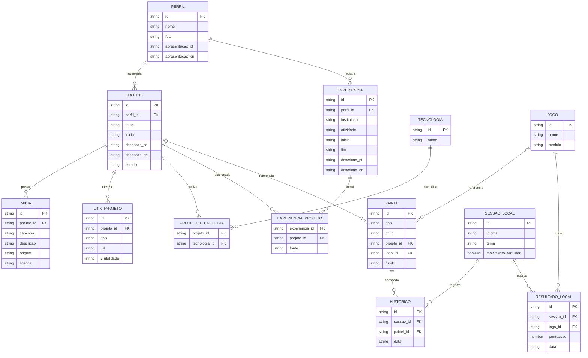
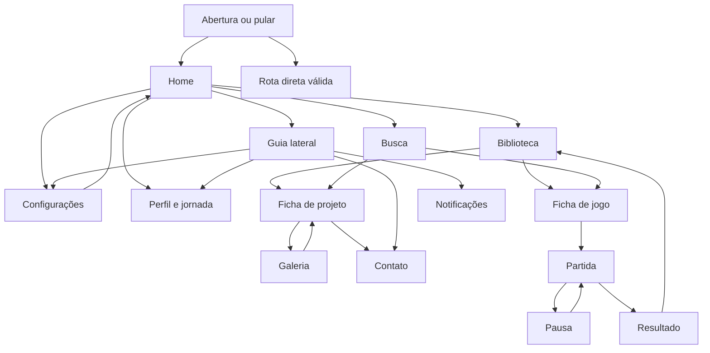

# Portfólio profissional: experiência inspirada no Xbox

Documento de produto e desenvolvimento • 17/11/2026 • planejamento, sem implementação. Plataforma: HTML, CSS e JavaScript. Referência atual: https://github.com/gustavoalkimim/Portifolio e https://gustavoalkimim.github.io/Portifolio/.

## Visão

Criar uma experiência de console para explorar a trajetória de Gustavo, com abertura cinematográfica, Home com mosaicos, Guia lateral e biblioteca navegável. O visitante pode conhecer projetos, experiências e contatos rapidamente ou ficar para jogar. Preservar conteúdo e fontes verdadeiras do portfólio existente; revisar os arquivos atuais antes de migrar dados, links e imagens. Não inventar biografia, datas, conquistas ou métricas.

### Princípios

- Aparência e lógica de console próximas das referências, mas com conteúdo profissional e identidade própria. Cada item precisa levar a conteúdo ou ação real.
- Acesso imediato ao conteúdo: botão “Pular abertura”, preferências de movimento reduzido e opção “Modo simples”. A introdução nunca impede o visitante de chegar aos projetos.
- Uso completo por mouse, teclado, toque e, quando disponível, controle. Não exigir conta, instalação ou hardware de Xbox.
- PT/EN abrangendo menus, acessibilidade, jogos, validações e status. Não traduzir imagens como se fossem texto.

## Fontes, escopo e precisão da referência

- [Xbox Wire: nova Home de 2023](https://news.xbox.com/en-us/2023/07/26/welcome-to-your-new-xbox-home/): atalhos superiores para Biblioteca, Microsoft Store, Game Pass, Busca e Configurações; itens recentes na parte inferior; fundo relacionado ao item; grupos fixados; comunidade e mídia.
- [Atualização Xbox de abril de 2026](https://news.xbox.com/en-us/2026/04/30/april-xbox-update-2026/): grupos, histórico e personalização; varia por plataforma.
- [Xbox Insider de novembro de 2026](https://news.xbox.com/en-us/2026/11/12/xbox-insiders-january-2027-console-features-1/amp/): opções de organização e posição do Guia são recursos em teste, não presumir disponibilidade geral.
- As 12 imagens fornecidas combinam Home de gerações diferentes (1–3 e 7), notificações (4), Guia lateral (5), aplicativo para PC (6, 11), loja (8, 12), biblioteca (9) e catálogo (10). Usá-las como referência visual, não como prova de que pertencem todas à mesma versão.
- [Mapa SVG pesquisado e adaptação proposta](mapa-xbox-portfolio.svg): `mapa-xbox-portfolio.svg`, junto deste documento. O lado esquerdo resume relações documentadas e observadas nas imagens; não é um inventário completo ou uma reprodução oficial de todas as abas Xbox. O lado direito é proposta. Confirmar nomes e ordem finais no console antes de alegar equivalência exata.
- Logo, som, imagens comerciais, marcas Xbox e jogos como Doom podem ter restrições. Prever abertura com marca própria e animação original inspirada na sequência solicitada; somente usar logo, áudio e recursos oficiais mediante licença aplicável. Não associar o projeto oficialmente à Microsoft. Jogos originais inspirados em gêneros, sem copiar código ou assets protegidos.

## Mapa funcional: toda aba proposta tem destino

| Referência | Aba do portfólio | Conteúdo e ação funcional |
|---|---|---|
| Home | Início | Destaques, recentes, projetos fixados, jogos e atalho de contato; seleção altera fundo quando habilitado. |
| My games & apps | Biblioteca | Catálogo de projetos e jogos; filtros por tipo/tecnologia, ordenação e busca local. |
| Store | Vitrine | Apresentar projetos como fichas, sem preços ou compras falsas; abrir detalhe, demo e repositório. |
| Game Pass | Jornada | Formação, experiências e projetos organizados em trilhas cronológicas. Não simular assinatura. |
| Search | Pesquisa | Buscar nome, descrição, tecnologia, experiência e configuração; resultados vazios úteis. |
| Settings | Configurações | Idioma, tema, volume, movimento, abertura e controle; persistência local e restauração. |
| Profile | Perfil | Foto, apresentação, formação, interesses e objetivos; links externos conferidos. |
| Guide/Home | Guia | Sobreposição com início, biblioteca, histórico e atalhos; voltar devolve foco ao item anterior. |
| People/community | Comunidade | Contatos reais, GitHub, LinkedIn e colaboração; sem amigos falsos, contas ou chat fictício. |
| Parties/chat | Mensagens | Formulário real já existente, validação e retorno; sem fingir bate-papo em tempo real. |
| Achievements | Conquistas | Marcos profissionais com fonte, ou conquistas locais dos jogos separadas das profissionais. |
| Capture/share | Capturas | Galeria de imagens reais dos projetos; copiar link e compartilhar quando API suportada. |
| Notifications | Notificações | Avisos reais da sessão: envio, conquista de jogo, erro, preferências. Sem atividades fabricadas. |
| Recent / Quick Resume | Recentes | Últimos painéis visitados armazenados localmente; retomar jogo só quando estado for realmente persistido. |
| Watch & Listen | Mídia | Capturas e vídeos autorizados de projetos; sem reprodução automática com som. |

As abas do Guia vistas nas imagens devem ser conferidas individualmente antes de definir ordem e nomenclatura definitiva. Barra de status exibe apenas dados disponíveis: hora local; conectividade como indicador aproximado; não inventar bateria de controle ou mensagens. A ação de busca funciona de qualquer tela; Esc/B fecha o modal ou volta um nível.

## Telas prioritárias e regras

1. **Boot:** fundo escuro, animação vetorial própria em CSS/SVG, transição breve à Home; progresso verdadeiro apenas quando houver recurso rastreável, sem percentuais inventados. Opção de pular desde o primeiro instante. `prefers-reduced-motion` desativa movimentos intensos. Não impor áudio.
2. **Home (imagens 1–3, 7):** avatar/cabeçalho, atalhos, plano de fundo amplo, faixa horizontal de cartões recentes, segunda faixa de atalhos e grupos abaixo. Item focado ganha contorno verde, nome e fundo apropriado; cartões de Projeto, Sobre, Experiências, Contato e Jogos são acessíveis sem rolagem excessiva. Em telas pequenas, áreas empilhadas e carrossel com botões visíveis.
3. **Guia (4–5):** painel lateral com seções navegáveis, atalhos de perfil, notificações, biblioteca e configurações. Modal com foco contido, Escape/B fecha e retorna foco; overlay clicável fecha sem perder estado. Notificações têm horário e botão limpar somente se forem reais.
4. **Biblioteca (6, 9–10):** grade com capa, categoria, filtros, ordenação, estados vazio e erro, paginação se necessária; projeto selecionado abre ficha. No celular, filtros viram controles expansíveis.
5. **Ficha (8, 11–12):** capa, título, data verdadeira, descrição, tecnologias, galeria, estado real e botões Abrir demo/Repositório. Ocultar ação sem destino, não criar métricas, classificação etária, avaliações ou amigos fictícios. Fisiogrip: captura real e informação de dados simulados; PetVet: MVP e lembretes planejados; Hub: projeto privado requer autorização de acesso.
6. **Perfil e jornada:** apresentação PT/EN, educação PUC Minas, interesses e objetivos conforme fonte; experiência conforme Figma existente. Timeline dos projetos do mais antigo ao mais recente, com datas conferidas na origem.
7. **Contato:** GitHub, LinkedIn, WhatsApp e e-mail com links fornecidos; mostrar telefone completo conforme última preferência. Nome/e-mail/mensagem, obrigatórios, validação, feedback acessível, envio EmailJS real e proteção contra duplicação. Não publicar segredos. IDs públicos ficam configuráveis; destinatário no template. Testar a URL publicada e confirmar recebimento.
8. **Busca e preferências:** busca instantânea local com correspondência sem acentos e sem resultados; idioma, movimento, som, tema, fundo e preferência de abertura persistem com tratamento de bloqueio de armazenamento.

## Jogos jogáveis

Todos devem ser projetos próprios, acessíveis a teclado e controle, com pausa, reinício, instruções, níveis de áudio, estado de vitória/derrota, botão voltar e ajuste de desempenho. Armazenar recordes apenas localmente; não chamar pontuação local de ranking mundial.

1. **Labirinto 2.5D:** FPS de exploração inspirado na tecnologia dos jogos antigos; raycasting simples em Canvas, colisão em grade, mapa próprio, coleta de chaves e saída. Controles WASD/setas + mouse opcional ou controle; alternativa sem pointer lock, mobile com joystick virtual. Sem conteúdo original de Doom.
2. **Nave arcade:** movimentação, obstáculos, tiros, vidas e fases progressivas com recorde local; duração de partida curta.
3. **Snake do código:** coletar itens e crescer sem colisões, velocidade ajustável e pausa; fase com grade legível.
4. **Memória de tecnologias:** pares de ícones próprios, tentativas e temporizador opcional, modo reduzido de animação. Tecnologia representada não comprova habilidade profissional.

Construir Snake e Memória primeiro; depois Nave; raycasting por último. Nenhum jogo pode bloquear a navegação para currículo ou contato. Encerrar loops, eventos e áudio ao sair; salvar progresso explicitamente quando suportado.

## Arquitetura técnica

Manter HTML, CSS e JS separados, sem frameworks de interface obrigatórios. Evoluir os três arquivos originais com módulos ES quando a complexidade justificar; não migrar para React/Vue sem decisão explícita. Modelo recomendado:

```text
index.html
style.css
script.js
src/
  dados/{perfil,projetos,experiencias,traducoes}.js
  interface/{home,guia,biblioteca,detalhe,busca,configuracoes}.js
  entrada/{teclado,controle,toque}.js
  servicos/{email,armazenamento,audio}.js
  jogos/{snake,memoria,nave,labirinto}.js
assets/{images,icons,fonts,audio}/
docs/{mapa-xbox-portfolio.svg,licencas}/
```

Os módulos acima são proposta futura; o site atual usa os três arquivos principais. Se manter literalmente três arquivos for obrigatório, consolidar módulos em `script.js` com funções separadas e carregar só os dados necessários. Scripts de desenvolvimento opcionais não devem ir para a entrega como dependências necessárias.

### Bibliotecas e APIs

| Opção | Uso | Decisão |
|---|---|---|
| Bootstrap CSS 5.3.8 | Grid, formulário e utilitários já usados | Manter inicialmente; aparência do console via CSS próprio. Conferir versão e integridade ao implementar. |
| Canvas 2D | Jogos, desenho e efeitos | API nativa; primeira escolha para jogos simples. |
| Gamepad API | Controles reais | Nativa, opcional; `navigator.getGamepads()` em `requestAnimationFrame`, deadzone, repetição e desconexão. [MDN](https://developer.mozilla.org/en-US/docs/Web/API/Gamepad_API/Using_the_Gamepad_API). |
| Web Audio API | Efeitos de jogos e volume | Nativa; iniciar som só após gesto do visitante, desligado por padrão na abertura. |
| EmailJS REST | Formulário | Preservar integração existente; credenciais públicas e conta sob controle do proprietário. |
| Phaser | Alternativa para jogos 2D mais elaborados | Opcional, estudar licença, versão e tamanho antes de adotar; não necessário para os quatro protótipos. [Documentação](https://docs.phaser.io/). |
| Three.js | Alternativa para 3D | Opcional, somente se o raycasting não atender; avaliar desempenho e acessibilidade. [Documentação](https://threejs.org/docs/). |
| Playwright | Testes automatizados de navegador | Dependência de desenvolvimento, não incluída no site; testes reais de controle complementares. [Documentação](https://playwright.dev/docs/intro). |

Não combinar bibliotecas por moda. Fixar versões efetivamente escolhidas e licenças no README; carregar jogos e mídia sob demanda; CDN tem dependência de rede. Continuar compatível com GitHub Pages usando caminhos relativos, HTTPS e sem servidor próprio. Não afirmar que existe autenticação ou sincronização em nuvem.

## Dados, navegação e estado

- Estado de UI: idioma, rota, painel ativo, foco anterior, modal, seleção, histórico, preferências e mensagens. Dados pessoais vêm de arquivos de conteúdo; HTML usa `textContent` para texto não confiável.
- Rotas por hash (`#/inicio`, `#/biblioteca`, `#/projetos/fisiogrip`, `#/jogos/snake`, `#/contato`, `#/configuracoes`), compatíveis com GitHub Pages. Voltar/avançar e links diretos precisam funcionar; rota inexistente mostra recuperação para início.
- Estado persistido no `localStorage`: idioma, aparência, movimento, volume, histórico limitado e recordes, com versão e valores padrão. Tratar falha de acesso e disponibilizar “limpar dados locais” com confirmação; sem cookies ou rastreadores desnecessários.
- Arquivos de jogo registram `iniciar`, `pausar`, `retomar`, `destruir` e `serializar` quando existir salvamento. Troca de tela chama `destruir` e cancela eventos/loops.
- Entrada unificada: mouse/clique e Tab/Enter/Espaço; setas ou D-pad navegam em linha/coluna; A confirma, B volta, Y busca quando o navegador permitir, Menu abre Guia. Mapeamento do botão central pode ser capturado pelo sistema e não deve ser requisito. Analog stick com deadzone e repetição controlada; não interceptar teclas durante digitação.
- O foco visual não substitui foco DOM; ordem de Tab previsível, `:focus-visible`, labels, contraste, nomes de ícones, status `aria-live`, diálogo semântico e controle para interromper animações. Sem rolagem horizontal da página; faixas horizontais com controles acessíveis.

## Minimundo

Gustavo mantém um acervo de projetos e experiências profissionais com títulos, datas, descrições bilíngues, tecnologias, links e mídias verificadas. Um visitante acessa o portfólio, abre painéis, filtra o acervo, lê detalhes e entra em contato. Pode jogar experiências autorais, conquistar marcos locais e salvar preferências no próprio navegador. Um painel pode representar um projeto, jogo, seção ou atalho. Projetos podem ter várias tecnologias e mídias; uma tecnologia pode estar em vários projetos. Uma experiência pode se relacionar a projetos quando houver fonte real. Mensagens seguem para EmailJS; o navegador não mantém uma caixa de entrada. A identidade do visitante não é exigida e os estados locais não representam contas reais.

### MER conceitual

O diagrama completo e canônico, com entidades, atributos e cardinalidades, está na **seção 7 — MER revisado** deste documento. Ele representa um modelo conceitual: o projeto estático não exige banco de dados ou contas de visitantes.

## Histórias de usuário e aceitação

- **Recrutador:** quero ver perfil e projetos sem jogar. Aceite: pular abertura, abrir Perfil e projeto em até três ações; GitHub e contato acessíveis por teclado.
- **Visitante com controle:** quero explorar e voltar sem mouse. Aceite: setas/D-pad, A/B, foco visível, retorno ao foco correto e desconexão sem travar.
- **Usuário no celular:** quero usar tudo com toque. Aceite: navegação, formulário e jogos com controles adequados; conteúdo legível e sem corte.
- **Pessoa com movimento reduzido:** quero evitar animações e sons. Aceite: detectar preferência, pular boot e permitir ajustes persistentes.
- **Pessoa internacional:** quero ler tudo em inglês. Aceite: todos os textos de interface e erros mudam; preferência persiste.
- **Jogador:** quero iniciar, pausar e sair sem perder navegação. Aceite: controles, vitória/derrota, recorde local, limpeza de recursos e retorno à biblioteca.
- **Visitante que contata:** quero saber se a mensagem foi enviada. Aceite: validação, carregamento e sucesso só após resposta confirmada; erro preserva dados e permite tentar novamente.
- **Proprietário:** quero adicionar projetos sem reescrever a interface. Aceite: adicionar registro bilíngue, imagens autorizadas e links; biblioteca, busca e detalhe refletem os dados.

## Plano de implementação e testes

1. Auditar repositório atual, links, assets, credenciais públicas e README; preservar site publicado enquanto se trabalha em cópia ou branch. Capturar baseline desktop e mobile.
2. Criar dados comuns e rotas; conferir paridade com conteúdo existente e cronologia. Construir Home, Perfil, Projetos, Experiências e Contato primeiro.
3. Criar Guia, biblioteca, detalhe, busca e preferências; adicionar foco/teclado e testes de navegação. Adicionar inicialização, pular e movimento reduzido.
4. Integrar Gamepad API, toque e áudio com fallback. Testar em navegadores e controle físico; relatar limitações verificadas.
5. Criar jogos em ordem crescente de complexidade, cada qual com pausa, retorno e testes. Lazy-load e orçamento de desempenho para evitar prejudicar o portfólio.
6. Validar tradução integral, links externos, imagens, formulários e entrega de mensagem no endereço real. Testar conexão instável, bloqueio de armazenamento, erro EmailJS e URL de projeto privado.
7. Testar 320, 375, 768, 1024 e desktop amplo em PT/EN; teclado completo, zoom 200%, leitor de tela e contraste; rodar auditoria automatizada e revisão manual. Publicar somente após verificação e autorização aplicável; validar rotas, assets e formulário na URL real.
8. Atualizar README com arquitetura, dependências/versionamento, licenças, créditos, comandos e demonstração. Registrar restrições reais e testes feitos.

Critérios de pronto: todas as abas propostas têm conteúdo/ação real; nenhum texto ou dado é inventado; modo simples e boot ignorável; contato realmente entrega; navegação acessível; quatro jogos efetivamente jogáveis ou escopo pendente declarado; nenhum asset protegido é usado sem licença; site publicado permanece funcional.

## Brainstorm: evolução possível

- Personalizar fundo por projeto, com alternância manual e opção de desativar.
- Fixar até um número configurável de projetos, restaurar ordem e esconder itens recentes sem remover conteúdo.
- Cartão “continuar explorando” baseado somente no histórico local.
- Filtros combinados por tecnologia, área, ano e tipo; preservar estado ao voltar da ficha.
- Comparar projetos lado a lado, exportar links e montar uma seleção para recrutador sem coletar dados.
- Linha do tempo com ligação entre projetos e experiências quando houver evidência.
- Modo entrevista que abre Sobre → Projeto → Contato em ordem, com progresso acessível.
- Explicações curtas de decisões técnicas e links para documentação de cada projeto.
- Galeria com zoom e legendas, vídeos com legendas e respeito a movimento reduzido.
- Central de notificações locais e histórico de envios da sessão sem guardar conteúdo sensível.
- Jogos com níveis de acessibilidade, modo daltônico, remapeamento e redução de efeitos.
- Conquistas de exploração opcionais, apagáveis, sem métricas falsas ou pressão ao visitante.
- PWA e uso offline apenas como etapa futura: cache versionado, atualização explícita e exclusão de dados; formulário informa que precisa de conexão.
- Compartilhamento via Web Share quando disponível, com botão de copiar como alternativa.
- Se um dia houver ranking online, autenticação, moderação, proteção contra abuso, política de privacidade e infraestrutura serão projetos separados; não simular nada disso na versão estática.


# Especificação detalhada para implementação

Esta seção complementa os requisitos anteriores. Valores de duração são pontos de partida para testes, não uma tentativa de reproduzir medições oficiais do Xbox. A navegação é inspirada nas imagens fornecidas, que combinam console, loja e aplicativo para PC.

## 1. Direção visual e composição

O cenário principal ocupa a janela inteira. Uma arte de fundo cobre a tela, preservando o ponto focal da imagem; um degradê escuro protege a leitura na base e nas laterais. A camada de conteúdo fica acima do fundo. O cabeçalho concentra avatar, identificação, atalhos de biblioteca, vitrine, jornada, pesquisa e preferências, além da hora. A região central deixa a arte respirar. A faixa inferior concentra cartões recentes; outra faixa reúne atalhos maiores; abaixo surgem grupos por tema. Em alturas pequenas, preservar cartões e permitir rolagem vertical sem esconder funções essenciais.

**Hierarquia:** o item focado possui contorno verde, escala discreta e título visível; os vizinhos continuam identificáveis. Um cartão sempre informa tipo e destino. Textos não podem depender da arte do fundo para contraste. Usar fonte local já disponível ou fallback de sistema e manter estilos simples e organizados. No mobile, reduzir densidade, manter os mesmos destinos e permitir toque, rolagem e acesso direto ao contato.

**Camadas:** fundo base → imagem de destaque → véu de contraste → interface → painel lateral → modal → notificação. Só o elemento mais alto recebe interação enquanto modal estiver aberto. Fundo não pode capturar cliques ou aparecer na árvore de acessibilidade como conteúdo relevante.

## 2. Fundos dinâmicos: regras completas

Cada tela e cada item de conteúdo pode declarar um `background` com imagem horizontal, versão mobile opcional, texto alternativo quando a imagem transmite informação, posição focal e cor de fallback. Começar com imagens já autorizadas e disponibilizadas; se um projeto ainda não tiver arte própria, usar fundo genérico coerente sem gerar uma captura falsa.

| Contexto | Fundo base | Mudança e retorno |
|---|---|---|
| Abertura | Escuro ou gradiente próprio | Ao terminar ou pular, aplicar o fundo salvo da Home. |
| Home | Arte padrão escolhida nas configurações | Focar cartão por um curto intervalo mostra sua arte; ao sair da faixa, restaurar o fundo da seção. |
| Biblioteca | Fundo neutro com leve textura | Destacar card pode pré-visualizar arte; filtro vazio mantém fundo da biblioteca. |
| Ficha de projeto | Arte de capa do projeto | A ficha fixa a própria arte; voltar restaura seleção e fundo anteriores. |
| Jornada e perfil | Arte própria discreta | Cada marco pode ter uma imagem relacionada, somente quando houver fonte. |
| Busca | Fundo da tela anterior escurecido | Ao fechar, restaurar tela, foco e fundo; resultados podem pré-visualizar suas artes. |
| Guia e notificações | Fundo atual mantido e escurecido | Abrir e fechar não provoca troca inesperada da arte. |
| Configurações | Fundo neutro | Prévia de tema reversível; salvar aplica, cancelar restaura. |
| Jogo | Tela própria do jogo | Pausa mantém quadro estático; sair devolve o fundo da biblioteca. |

Implementação proposta com duas camadas de imagem: a atual permanece visível enquanto a próxima carrega e decodifica; então ocorre transição gradual entre elas. Se o carregamento falhar, manter a imagem anterior ou usar cor sólida. Uma troca solicitada após outra invalida o resultado mais antigo para evitar imagem errada ao navegar rapidamente. Não atualizar o fundo em todo `mousemove`: somente quando muda o foco efetivo. Aplicar pequeno atraso para evitar piscar quando o usuário percorre vários cards rapidamente. Cancelar temporizadores ao trocar de tela. Pré-carregar somente artes adjacentes, limitar tamanho e manter versões comprimidas; não baixar todas as imagens de uma vez.

Adicionar controles: **fundo dinâmico ligado/desligado**, imagem padrão, contraste reforçado e movimento reduzido. Com movimento reduzido, trocar instantaneamente ou usar transição quase imperceptível; nunca aplicar paralaxe obrigatória. Não usar vídeos automáticos pesados como plano de fundo sem alternativa estática.

## 3. Catálogo de transições e animações

| Evento | Animação proposta | Regra funcional |
|---|---|---|
| Primeiro acesso | Emblema próprio surge, pulsa suavemente e desaparece; Home aparece progressivamente | Pular disponível desde o início; não usar logo ou som oficial sem licença. |
| Foco em cartão | Contorno aparece e cartão cresce levemente | Foco DOM e foco visual sincronizados; não deslocar outros elementos. |
| Foco em item de barra | Linha ou realce se desloca ao item selecionado | Não repetir animação se o foco não mudou. |
| Troca de fundo | Dissolução entre duas camadas | Esperar imagem carregar; manter último pedido válido. |
| Abrir ficha | Home perde destaque e ficha entra em leve deslocamento/fade | Ao concluir, levar foco ao título ou primeiro comando; não atrasar ações. |
| Voltar da ficha | Ficha sai, lista retorna | Restaurar card, posição de rolagem e fundo; fallback para primeiro item se removido. |
| Abrir/fechar Guia | Painel desliza lateralmente com fundo escurecido | Foco preso ao painel; Esc fecha; foco volta ao gatilho. |
| Trocar aba no Guia | Conteúdo anterior sai discretamente e novo conteúdo aparece | Cabeçalho de abas permanece estável; mudança rápida cancela animação anterior. |
| Pesquisa | Campo abre e resultados se atualizam sem saltos | Anunciar quantidade com moderação; digitar nunca aciona atalhos de jogo. |
| Notificação | Cartão aparece na borda e desaparece depois de período ajustável | Informação importante persiste em central; não anunciar o mesmo aviso repetidamente. |
| Tela de jogo | Transição de carregamento da sessão | Exibir apenas progresso real; falha oferece repetir ou voltar. |
| Pausa | Véu escuro e menu surgem | Congelar lógica, entrada do jogo e áudio; retomar só com ação explícita. |

Parâmetros iniciais: movimentos simples de aproximadamente 150–250 ms; mudanças de tela/fundo cerca de 250–400 ms, ajustáveis em testes. Priorizar `transform` e `opacity`, não animar propriedades que recalculem o layout em cada quadro. O estado lógico deve ser atualizado corretamente mesmo com animação interrompida. Sem movimento: manter clareza de foco e usar mudança direta. Nada de flashes rápidos, animação infinita intrusiva ou esperar animação para habilitar conteúdo essencial.

## 4. Fluxos completos por tela

### Abertura e primeira visita

1. Carregar HTML legível e iniciar conteúdo mínimo do aplicativo.
2. Verificar preferência de movimento e inicialização anterior; oferecer botão “Pular” com foco acessível.
3. Apresentar animação criada para o projeto e, se o visitante habilitar sons, reproduzir apenas áudio autorizado.
4. Se recursos demorarem ou falharem, mostrar mensagem útil e oferecer entrada direta na versão simples.
5. Encaminhar para Home com foco no primeiro atalho; não depender da conclusão de carregamentos de jogos.

### Home, linhas e grupos

- A barra superior dá acesso imediato a biblioteca, vitrine, jornada, pesquisa e preferências; a identificação do perfil abre Sobre.
- A primeira linha mostra recentes e destaques do portfólio. Selecionar um card abre sua ficha; jogos abrem ficha com descrição e botão Jogar.
- A segunda linha apresenta Projetos, Sobre mim, Experiências, Contato e Jogos; nenhum depende de histórico.
- Ao rolar, mostrar projetos por tecnologia, linha do tempo e jogos autorais. Grupos só aparecem se houver conteúdo.
- Navegação em linhas mantém o índice mais próximo possível ao trocar verticalmente. Se não existir item equivalente, selecionar o último disponível. Em carrosséis, foco deve rolar para dentro da área visível.
- Recência e favoritos são locais e limitados. Sem dados, mostrar destaques fixos verdadeiros; não inventar atividade de terceiros.

### Guia e subabas

Abrir pelo botão visível, por tecla documentada e por botão de controle disponível. Cabeçalho contém abas; o corpo exibe a seção ativa; rodapé contém atalhos. As seções têm ações reais: **Início** volta à Home; **Biblioteca** lista projetos e jogos; **Pessoas** abre contatos e redes; **Mensagens** leva ao formulário; **Conquistas** mostra marcos verificáveis e conquistas locais de jogo separadamente; **Capturas** abre galeria; **Perfil e sistema** abre Sobre e preferências. As nomenclaturas são uma adaptação proposta, pois as telas fornecidas representam versões diferentes. Voltar fecha primeiro submenus, depois o Guia; um modal de confirmação tem precedência sobre ambos.

### Notificações

Registrar somente eventos que aconteceram na sessão: envio aceito ou recusado, jogo concluído, preferência salva e falha de mídia. Mostrar texto, horário local e botão de acesso ao contexto quando aplicável. Central vazia informa que não há notificações. A marcação como lida e limpeza são locais; avisos críticos devem continuar legíveis até o visitante agir. Não usar supostas amizades, instalação ou convites de terceiros.

### Biblioteca e vitrine

Cartões reutilizáveis com capa, título, tipo e tecnologia principal. Filtros: projetos/jogos/todos, tecnologia, ano confirmado e acessibilidade; ordenação por nome, cronologia ou recente local. Não mudar ordem cronológica apresentada na linha do tempo. Busca sem resultados oferece limpar filtros. Dados ausentes mostram campo omitido ou “informação não disponível”, sem placeholders enganosos. Ao reabrir a biblioteca, manter filtros e item quando possível. A vitrine não oferece compra: CTA é “Ver projeto”, “Abrir demonstração” ou “Jogar”.

### Detalhe de projeto e galeria

Exibir título, resumo, período confirmado, tecnologias, papel e estado real. Ações: repositório, demonstração quando existir, galeria e voltar. Informar quando link é privado e pode exigir acesso. A galeria navega por setas, permite ampliar e fechar por teclado; definir descrição e licença de cada mídia. Não simular estrelas, números de downloads, preços, avaliações ou progresso de implementação.

### Perfil, experiência e jornada

Perfil reaproveita dados verdadeiros, foto e textos bilíngues. Experiências listam instituição, atividade, período e descrição confirmados. Jornada organiza formação e projetos numa cronologia, destacando o foco; cada marco abre detalhe e pode ligar a projetos apenas quando houver relação comprovada. Campos sem fonte ficam pendentes de confirmação, nunca preenchidos por inferência.

### Busca, configurações e contato

Busca indexa conteúdo previamente carregado e retorna tipo, título, trecho e destino. Normalizar maiúsculas e acentos; não enviar termos a serviço externo. Configurações têm valor atual, opções, descrição, salvar e restaurar padrão; mudanças de idioma atualizam labels, mensagens, jogos e status, preservando foco. Contato mantém os links já fornecidos e o formulário real: validar obrigatórios e formato de e-mail, desabilitar reenvio durante a requisição, indicar carregamento, mostrar sucesso somente após confirmação da API e preservar campos em erro. Confirmar recebimento real ao testar publicação.

## 5. Especificação dos quatro jogos

### Labirinto 2.5D

Cena própria baseada em raycasting sobre matriz de paredes. Tela inicial explica objetivo, controles, pausas e saída. Jogador move e gira; colisão impede atravessar paredes; encontra chaves e chega à saída. HUD com chaves coletadas, tempo opcional e botão Pausa. Estados: carregando → menu → jogando → pausado → vitória/derrota → reiniciar ou sair. Implementar primeiro uma sala, depois mapa, texturas autorais e dificuldade. Reduzir resolução interna em aparelhos lentos, manter fallback sem pointer lock e controles táteis. Conteúdo inspirado em jogos de tiro clássicos não inclui Doom ou recursos protegidos sem licença.

### Nave arcade

Uma nave movimenta-se numa área delimitada, dispara projéteis e evita ondas de obstáculos. Definir colisões, vidas, dificuldade gradual e pontuação local. Estados de pronto, jogo, pausa, derrota e recorde. Controles: teclado/setas e espaço, controle e botões touch. Invulnerabilidade temporária após colisão deve ser visível sem flashes rápidos. Verificar que reiniciar limpa projéteis, timers e listeners.

### Snake

Grade com direção, alimento, crescimento e colisão com corpo/limites. Não permitir inversão de 180 graus instantânea. Escolher posições livres para alimento e detectar vitória ao preencher grade. Velocidade e contraste ajustáveis, pontuação e recorde locais. Pausar ao perder foco, retomar apenas por ação do visitante; touch com botões direcionais, sem exigir gestos difíceis.

### Memória

Grade de pares com símbolos originais e rótulos acessíveis. Selecionar até duas cartas; se iguais, manter reveladas; se diferentes, aguardar breve intervalo e virar. Bloquear seleção extra durante comparação, contar tentativas, detectar conclusão, permitir reiniciar e sair. Modo sem tempo e com movimento reduzido; teclado e leitor de tela anunciam carta e estado sem revelar os pares antecipadamente.

## 6. Minimundo expandido

Gustavo é o titular de um portfólio com apresentação, formação, contatos e objetivos. Ele publica projetos em que participou e registra experiências profissionais ou acadêmicas; cada informação possui fonte verificável. Projetos têm descrição em português e inglês, um período, tecnologias, links e nenhuma ou várias mídias. Uma tecnologia pode classificar muitos projetos; a mesma experiência pode estar ligada a vários projetos, mas somente quando tal relação for verdadeira. Um projeto pode existir sem experiência associada.

O portfólio contém painéis navegáveis, como Perfil, Projeto, Jogo, Galeria e Contato. Um painel pode apontar para um projeto, para um jogo ou para uma seção geral, de acordo com seu tipo. Visitantes não criam conta: cada navegador mantém uma sessão local com preferências, histórico e recordes quando o armazenamento está disponível. O visitante pode pesquisar o catálogo, abrir detalhes, jogar, mudar idioma e enviar uma mensagem. O formulário solicita nome, e-mail e mensagem, transmite a um serviço de e-mail e informa o resultado; não existe sistema próprio de caixa de entrada ou banco de usuários.

Cada jogo tem regras e resultados próprios. Pontuações, conquistas e histórico ficam restritos ao navegador, podendo ser apagados. Elas não comprovam formação, cargo, experiência ou reconhecimento profissional. Caso um dia seja necessário sincronizar usuários, o backend, consentimento e privacidade deverão ser projetados separadamente.

### Regras de negócio e cardinalidades

1. Um perfil tem zero ou muitas experiências e zero ou muitos projetos; cada registro profissional pertence ao perfil do portfólio.
2. Um projeto tem zero ou muitas mídias e links; cada mídia e link cadastrado pertence a um projeto. Uma mídia também pode ter origem e licença próprias.
3. Projeto e tecnologia relacionam-se muitos para muitos por `PROJETO_TECNOLOGIA`; uma tecnologia pode existir antes de ser associada.
4. Experiência e projeto relacionam-se muitos para muitos por `EXPERIENCIA_PROJETO`; essa associação é opcional e exige evidência.
5. Um visitante local pode acessar vários painéis em momentos diferentes; cada evento de histórico aponta para um painel e uma sessão local.
6. Um jogo pode gerar muitos resultados locais; cada resultado pertence a uma sessão e a um jogo. O recorde é calculado entre resultados válidos locais.
7. Um painel pode referenciar zero ou um projeto e zero ou um jogo; a aplicação valida que o tipo não aponta simultaneamente para ambos. Painéis gerais não precisam de entidade de destino.
8. Uma mensagem é uma tentativa de envio, não uma entidade armazenada permanentemente no portfólio. Não incluir nome e e-mail em histórico local.

## 7. MER revisado: entidades, atributos e relações

O diagrama representa a estrutura lógica; não significa que será criado um servidor ou banco de dados. As entidades de catálogo podem ser arquivos JS/JSON e as de sessão podem usar `localStorage`. Chaves compostas são verificadas pela aplicação. Este diagrama substitui o bloco Mermaid resumido anterior se houver divergência de formatação.



Exemplo: um projeto PetVet pode ter vários registros de tecnologia e uma captura; um visitante pode abrir sua ficha e depois iniciar Snake. Isso cria histórico e resultado locais apenas se o armazenamento estiver disponível. Não presumir qualquer ligação entre PetVet e uma experiência sem fonte.

## 8. Histórias de usuário detalhadas

**Recrutador abre projeto:** Dado que estou na Home, quando seleciono Projetos, vejo a biblioteca. Ao abrir uma ficha vejo descrição, tecnologias, imagens e repositório; ao voltar, retorno à mesma posição. Se o repositório for privado, sou avisado antes de depender dele.

**Navegação com controle:** Dado controle conectado e página ativa, quando uso direcional, o foco percorre elementos visíveis; A ativa; B fecha primeiro a camada superior. Se desconectar, o jogo pausa e o teclado permanece funcional. Botões reservados pelo sistema não são obrigatórios.

**Personalização de fundo:** Dado que selecionei fundos dinâmicos, ao focar um projeto por um curto período vejo a arte dele. Ao sair do cartão, volto ao fundo correspondente à tela. Se desligar a opção, a preferência permanece após recarregar; uma imagem indisponível não impede uso.

**Idioma e contato:** Dado que escolhi inglês, textos e erros do formulário mudam. Se preencher email inválido, o campo recebe explicação. Se a API rejeitar o envio, os dados permanecem e vejo erro; se aceitar, vejo sucesso. Confirmar recebimento em teste real.

**Jogo acessível:** Dado que abri Snake, consigo ler controles, iniciar, pausar, reiniciar e voltar. Meu recorde fica somente no navegador; se o armazenamento falhar, recebo informação sem interromper a partida.

## 9. Checklist técnico e visual de aceite

- [ ] Cada tela tem fundo padrão, fallback, comportamento ao entrar, sair, focar, abrir modal e retornar.
- [ ] Trocas rápidas não deixam fundo atrasado, animação pendurada, foco preso ou recursos duplicados.
- [ ] Boot é pulável, sem som obrigatório e respeita movimento reduzido.
- [ ] Todas as abas listadas têm destino e ação; serviços inexistentes não são simulados.
- [ ] Guia, busca, modais e jogos devolvem foco e posição ao fechar.
- [ ] Teclado, controle e toque funcionam sem depender uns dos outros; testar controle real e relatar exceções do navegador.
- [ ] Informações, datas, fontes, links e licenças conferidas; Hub privado indicado corretamente.
- [ ] Contraste, zoom, leitor de tela, foco visível, imagens alternativas e PT/EN verificados.
- [ ] Jogos apresentam menu, controles, pausa, reinício, término, saída e descarte de recursos.
- [ ] Testes de erro incluem rede, mídia, armazenamento, EmailJS e controle desconectado.
- [ ] Site e formulário são testados na publicação final; dados privados não entram no código.

## 10. Brainstorm adicional

- Trilhas por interesse: recrutador, colega desenvolvedor, professor e visitante que quer jogar, todas opcionais.
- Iluminação e cor de destaque definidas por projeto, respeitando contraste e preferência reduzida.
- Mapa visual de habilidades com evidências vinculadas a projetos reais, sem porcentagens inventadas.
- Histórico de navegação local com remoção individual; favoritos exportáveis como lista de links.
- Comparação de decisões e tecnologias entre projetos; legendas claras para MVP, protótipo e projeto concluído.
- Modo de apresentação com roteiro discreto e atalhos para Figma, projeto, código e contato.
- Conquistas locais por explorar, com opção de desativar; nunca misturar com experiência profissional.
- Painel de desempenho que permita reduzir qualidade dos jogos, ocultar imagens pesadas e silenciar efeitos.
- Futuros comandos de voz, sincronização e placar online exigem projeto e validação próprios; não incluir botões falsos antecipadamente.


# Especificação avançada: experiência de console e critérios de excelência

Esta parte aprofunda o projeto anterior e tem precedência sobre propostas resumidas em caso de conflito. Trata-se de especificação futura. O objetivo é uma experiência visual e comportamental muito próxima das referências, sem presumir que imagens de versões diferentes formem uma única interface oficial. As decisões de medidas e tempos abaixo são hipóteses ajustáveis após comparação visual com as imagens e testes em dispositivos reais.

## 11. Matriz de fidelidade por imagem fornecida

| Referência | Observação visual a reproduzir/adaptar | Implementação e verificação |
|---|---|---|
| 1 | Home com topo discreto, fundo amplo escuro, faixa de capas e segunda linha de blocos | Preservar proporção geral; comparar alinhamentos e espaço vazio em captura desktop; cada bloco leva a um destino real. |
| 2 | Capa selecionada maior com borda luminosa, fileira de vizinhos, grupos abaixo | Criar variantes de card ativo/inativo; verificar que ampliação não recorta vizinhos. |
| 3 | Fundo muda conforme item, faixa inferior sobre imagem de destaque | Fundo em duas camadas, recorte focal e gradiente; testar transições rápidas. |
| 4 | Notificações em sobreposição, listagem e relógio | Central local real, com lida/não lida e empty state; não simular notificações sociais. |
| 5 | Guia lateral com abas por ícones, linha selecionada, recentes e atalhos inferiores | Painel lateral adaptável, ícones autorais com rótulos acessíveis e retorno ao foco correto. |
| 6 | Aplicativo PC com barra lateral, busca, biblioteca e cards em grade | Tela de biblioteca desktop opcional com sidebar recolhível; no celular, filtros em painel. |
| 7 | Home com destaques, atalhos, grupos inferiores e comandos contextuais | Rodapé de dicas muda conforme o foco e o método de entrada ativo. |
| 8 | Loja com navegação lateral, card grande em destaque e catálogo | Vitrine de projetos sem preço nem transações falsas; detalhamento profissional. |
| 9 | Biblioteca com abas, filtros, ordenação e grade | Filtros combináveis, contagem real e preservação de estado; sem número fictício de itens. |
| 10 | Catálogo em seções horizontais, capa vertical e botão ver tudo | Agrupamento por categoria real; “Ver tudo” aplica filtro específico. |
| 11 | Página de detalhe com capa, descrição e botões | Ficha com tecnologias, papel confirmado, links válidos, mídia e ações de compartilhamento. |
| 12 | Busca com destaque, resultados, filtros e detalhes | Busca local com ranking explícito, navegação em resultados e tratamento de ausência. |

Checklist de fidelidade: comparação lado a lado em resolução desktop e widescreen; verificar ordem visual, densidade, alinhamento, margens, recortes, contraste e transições. Registrar diferenças deliberadas por acessibilidade ou conteúdo. Não alegar fidelidade perfeita sem medição e comparação efetiva.

## 12. Sistema visual minucioso

### Composição espacial

Usar uma grade baseada em unidades simples (por exemplo 4, 8, 16, 24 e 32 px), sem amarrar a interface a uma resolução única. Configurar uma área segura responsiva, com margem suficiente para TVs e telas menores. A Home precisa ter: cabeçalho, área de respiro visual, trilho de itens recentes, trilho de atalhos e grupos abaixo da dobra. Em desktop, os trilhos rolam horizontalmente sem deslocar a página inteira; em mobile, usar cartões com tamanho de toque confortável, setas opcionais e rolagem por toque. A tela não deve depender de hover.

Definir variantes de cartão: quadrado compacto, pôster vertical, panorâmico, atalho pequeno, atalho largo e cartão de detalhe. Cada variante tem área reservada para capa, fallback, rótulo, indicador de tipo e foco; tamanhos são controlados por CSS e responsivos. Textos longos quebram ou têm truncamento com nome completo acessível. A mesma informação não pode desaparecer apenas porque o cartão perdeu foco.

### Tokens e componentes

Tokens CSS: superfícies base e elevadas, bordas discretas, contraste do texto, cor de realce configurável, foco, erro, sucesso, tamanhos tipográficos, espaçamento, duração e curva de movimento. Componentes: cabeçalho, relógio, cartão, trilho, grupo, painel lateral, abas, barra contextual, menu de opções, diálogo, notificação, campo de busca, filtros, detalhes, player de mídia e área de jogo. Cada componente descreve propriedades, estados, teclado, controle, toque e tradução. Estados: padrão, foco, hover, pressionado, ativo, carregando, indisponível, erro, vazio e movimento reduzido.

Ícones devem ter desenho consistente e nome acessível; a marca Xbox e ícones oficiais só podem entrar com permissão/licença aplicável. Não usar o logotipo como se o site fosse produto oficial da Microsoft. Não criar identificação visual enganosa de compra, assinatura, conquistas oficiais ou conexão com conta Xbox.

## 13. Abertura e retorno à Home como máquina de estados

Estados propostos: `boot-inicial` → `verificar-preferencias` → `abertura` → `preparar-home` → `home`; transições laterais para `pular`, `erro-de-recurso` e `modo-simples`. O HTML inicial precisa oferecer uma ligação real para o conteúdo enquanto o script carrega. Em caso de JavaScript indisponível, fornecer uma página de conteúdo básico com nome, projetos e contato, ou informar claramente a limitação quando não for possível.

A animação usa marca própria criada para o portfólio, com círculo, construção por máscaras e aparecimento do nome; escala, brilho e som devem ser testados sem flashes. Botão Pular presente no DOM e alcançável desde o primeiro quadro; Enter, Espaço e toque o acionam. Preferência “não mostrar abertura novamente” em configurações; visitante pode reativar. Redução de movimento remove a sequência, sem remover acesso. Se a página for reaberta numa rota profunda, após boot manter destino solicitado e não redirecionar à Home sem motivo.

## 14. Motor de fundos e pré-visualização

Cada tela recebe um fundo padrão e cada card pode ter uma arte de pré-visualização. Estrutura sugerida: `id`, `srcDesktop`, `srcMobile`, `focusX`, `focusY`, `corFallback`, `descricao`, `fonte`, `licenca`, `prioridade`. Nunca usar `descricao` vazia para mídia que contenha informação essencial. Fundo puramente decorativo deve ser ignorado por leitores de tela, enquanto a ficha traz informação equivalente em texto.

Ao mudar foco: cancelar agendamento anterior → aguardar curta estabilização → selecionar variante adequada → carregar/decodificar em segundo plano → conferir se a solicitação ainda corresponde ao foco atual → alternar camadas → limpar referência anterior. Em falha, manter fundo válido e registrar aviso técnico sem perturbar navegação. Pré-carregamento só para vizinhos previsíveis; limitar memória, revogar URLs temporárias e cancelar ao sair.

Prioridade de fundo: configuração de movimento/desempenho → jogo em primeiro plano → ficha aberta → prévia do card selecionado → fundo padrão da tela → fallback sólido. Guia, menu contextual e notificações não alteram essa pilha. A opção de fundo estático desativa prévias; temas de alto contraste reforçam o véu. Troca de idioma não força recarregamento da imagem.

## 15. Navegação espacial e controle de foco

Construir um controlador de foco com regiões identificadas: barra superior, trilho recente, atalhos, grupos, rodapé contextual e overlays. Em cada região, armazenar último item válido. Mover horizontalmente para o próximo card visível; mover verticalmente procura o elemento da região adjacente mais próximo no eixo horizontal. Quando não houver candidato, não saltar para controle imprevisível; rolagem revela novos itens. A tecla Tab segue uma ordem DOM coerente e sempre permite sair do componente.

Controle: ler estado por quadro via Gamepad API, com tratamento de `mapping` e fallback; D-pad e analógico navegam, A ativa, B volta quando disponível. Implementar zona morta configurável, detecção de borda do botão, repetição inicial e repetição contínua sem múltiplas ativações. Rótulos A/B/X/Y devem surgir apenas quando realmente houver controle reconhecido; teclado e toque exibem orientações apropriadas. Botão central pode ser capturado pelo sistema e nunca pode ser o único meio de abrir o Guia.

O usuário pode remapear ações de gameplay e inverter eixos de forma independente quando o jogo os usa. A navegação de interface permanece possível com comandos simples, sem combinações simultâneas obrigatórias. No desktop, clique em campo de texto suspende atalhos; composição de texto e leitores de tela não podem ser interrompidos. Ao reconectar controle, não iniciar nem retomar jogo automaticamente.

Fontes: [Microsoft — navegação espacial para controle](https://learn.microsoft.com/en-us/windows/uwp/ui-input/gamepad-and-remote-interactions); [Xbox Accessibility Guideline 112](https://learn.microsoft.com/en-us/gaming/accessibility/xbox-accessibility-guidelines/112); [Xbox Accessibility Guideline 113](https://learn.microsoft.com/en-us/xbox/accessibility/xbox-accessibility-guidelines/113). Estas são orientações de projeto, não confirmação de conformidade.

## 16. Sistema de sobreposições e menus contextuais

Pilhas permitidas: tela → Guia ou busca → menu contextual → confirmação. Cada camada guarda gatilho, foco anterior e estado de rolagem. Esc/B fecha somente a camada superior; clicar fora fecha apenas quando isso não gerar perda de dados. Ao abrir modal, desativar interação com camada inferior e controlar foco; ao fechar, restaurar foco se o gatilho existir, senão ir ao próximo elemento lógico. Armazenar preferências de lado do Guia como recurso próprio; a personalização de lado mencionada pela Microsoft em novembro de 2026 era recurso Insider, não presumir disponibilidade universal ([Xbox Wire](https://news.xbox.com/en-us/2026/11/12/xbox-insiders-january-2027-console-features-1/)).

Menu contextual de projeto: Abrir, Ver repositório, Fixar/desafixar, Compartilhar, Copiar link, Ver detalhes e Ocultar dos recentes. Mostrar apenas ações suportadas; esconder dos recentes não exclui projeto nem fonte. Menu de jogo: Jogar, Continuar apenas se houver estado válido, Reiniciar com confirmação e Ver controles. Menu de histórico: abrir, remover item ou limpar histórico mediante confirmação. Todos os menus apresentam nomes claros, estado marcado e alternativa por toque.

## 17. Home e personalização avançadas

Linha superior pode incluir horários locais, nome do portfólio e avatar, atalhos e botão do Guia. Não exibir como fatos bateria, conta, status online de amigos, gamerscore ou assinaturas se não houver dado e integração reais. A hora deve atualizar sem provocar rerender do catálogo inteiro.

Modelo de grupo: `id`, `tituloPT`, `tituloEN`, `tipo`, `filtro`, `ordem`, `fixado`, `itens`. Grupos padrões: projetos recentes conforme datas verificadas, projetos por tecnologia, jogos autorais, trajetória e contato. Favoritos são IDs, não duplicatas de conteúdo; excluir ou tornar indisponível um item remove referência órfã sem corromper preferências. Usuário pode fixar e reordenar grupos localmente; oferecer comandos mover antes/depois acessíveis, além de arrastar opcional. Limites definidos em configuração, sem prometer reprodução exata da versão do console.

Retorno inteligente: ao voltar, preservar rota, filtros, rolagem e card; ao reabrir em nova sessão, não iniciar jogo automaticamente. Histórico recebe timestamp local e não inclui dados de formulário. A opção de limpar histórico tem explicação do efeito; limpar não apaga recordes ou configurações, salvo escolha explícita.

## 18. Busca e descoberta avançadas

Índice construído a partir de dados bilíngues: título, sinônimos controlados, descrição, tecnologias, categoria e tags. Normalização por caixa e diacríticos; resultados ordenados por correspondência exata de título, prefixo, tecnologia e descrição; desempate explícito e estável. Exibir categoria, trecho e link para ficha. Buscar projetos, jogos, experiências e configurações; não incluir dados pessoais não publicados ou mensagens enviadas.

Estados: sem texto com sugestões locais, digitando com debounce, resultados, filtros ativos, nenhum resultado, falha de índice e carregamento parcial. Não mover o foco a cada tecla; anunciar mudanças relevantes por região acessível com atraso. Atalhos de seleção, limpar e filtros devem continuar disponíveis no toque. Pesquisa por URL deve codificar caracteres e não expor informação sensível a terceiros.

## 19. Módulos de serviços e contratos

`catalogo`: `listar`, `buscar`, `obterPorId`, `filtrar`; retornos previsíveis e dados imutáveis. `router`: `navegar`, `voltar`, `lerRota`, `inscrever`; rota inválida oferece recuperação. `focus`: `registrarRegiao`, `mover`, `restaurar`, `remover`; elementos desmontados não devem permanecer registrados. `background`: `solicitar`, `cancelar`, `restaurar`, `destruir`. `storage`: `carregar`, `salvar`, `migrar`, `limparPorCategoria`, com tratamento de quota e JSON inválido. `audio`: volumes master/interface/jogo, mute e limpeza. `notifications`: registrar, listar, marcar e limpar; dados estritamente locais. `email`: validar, enviar, cancelar quando possível, normalizar erro e preservar dados. `games`: iniciar, pausar, retomar, serializar quando suportado, destruir.

Separar dados, estado, renderização e efeitos. Usar módulos ES se autorizado; não criar build complexo para uma página estática sem necessidade. Carregamento tardio para jogos, imagens grandes e telas secundárias. Estabelecer versão de schema em armazenamento; se migração falhar, voltar a valores seguros sem apagar dados automaticamente. Não declarar mensagens como entregues enquanto o serviço não confirmar e não confundir aceitação da API com leitura pelo destinatário.

## 20. Jogos: critérios de profundidade adicionais

Todos: tempo de partida e objetivo claros, tutorial reproduzível, remapeamento adequado, volume independente, pausa, saída, foco, visibilidade de estado e modo reduzido. Não usar `alert` nativo para conduzir jogo. Após sair, provar que não restam loop ativo, temporizador, ponteiro preso ou áudio tocando. Resultados possuem versão de jogo; não misturar pontuações de regras incompatíveis.

Labirinto: especificar célula vazia/parede/porta/chave/saída; raio percorre a grade até atingir parede ou limite; distância corrigida para perspectiva; colisões respeitam raio do jogador; mapa tem rota solucionável. Oferecer sensibilidade, inversão de eixo, tamanho do campo de visão, redução de movimento e opção de mira simples. Mostrar tela de pausa caso a aba perca visibilidade. Evitar chamar o produto de Doom e não distribuir WADs, sons, mapas ou arte proprietários.

Nave: fases com padrões determinísticos opcionais, limites de entidades e colisões previsíveis; garantir que jogador pode vencer sem consumir memória indefinidamente. Separar dano, invulnerabilidade, pontuação e progressão. Snake: passo fixo desacoplado do framerate, fila de direção limitada, situação de tabuleiro cheio e controle de velocidade. Memória: gerar pares sem dependência apenas de cor, controlar temporizador que congela na pausa, impedir terceira seleção e anunciar resultado ao leitor.

## 21. Segurança, privacidade e robustez

Projetos, descrições e buscas são renderizados como texto; validar URLs antes de criar links e restringir protocolos. Links externos abrem com indicações apropriadas e `rel` seguro. Evitar HTML construído com entrada de formulário. Nenhuma chave privada, senha, token administrativo ou dados de visitantes no código. EmailJS usa identificadores públicos; planejar limites de uso e ações contra abuso conforme serviço e plano reais. Não adicionar analítica ou cookies sem decisão e documentação.

Tratar ausência de rede, requisição expirada, origem não autorizada, serviço fora do ar e respostas inesperadas. Em falha do armazenamento, site e jogos continuam em memória, com aviso quando persistência for importante. Diferenciar erro de envio, aceitação pela API e confirmação efetiva pelo proprietário. CSP e políticas de segurança devem ser compatíveis com GitHub Pages e serviços utilizados; testar em vez de prometer cabeçalhos que hospedagem não oferece.

## 22. Matriz de testes exigentes

| Área | Casos positivos | Falhas, limites e evidência |
|---|---|---|
| Boot | Primeira visita, revisita, rota profunda, pular | JS desativado, recurso lento ou falho, movimento reduzido; captura e tempo até conteúdo. |
| Navegação | Cada aba, todos os cartões, voltar, histórico, foco | Fechar overlay aninhado, foco removido, redimensionar durante transição. |
| Fundo | Cada tela e cartão, opção estática, mobile | Imagem 404, conexão lenta, foco rápido A→B→C; C deve prevalecer. |
| Idioma | PT/EN em todas telas e jogos | Trocar durante erro, loading, modal ou partida; labels e estado preservados. |
| Controle | D-pad, analógico, A/B, remapeamento | Desconexão, botões mantidos, dois controles, guia do sistema, campo de texto. |
| Layout | 320, 375, 768, 1024, widescreen e TV | Zoom 200%, fonte ampliada, texto longo, largura reduzida e orientação alterada. |
| Acessibilidade | Tab, foco, contraste, labels, leitor | Movimento reduzido, sem mouse, sem cor como única indicação, modal fechado corretamente. |
| Catálogo | Filtro, busca, ordenação, favorito, item privado | Zero resultados, acentos, campo ausente, link quebrado e arte ausente. |
| Formulário | Envio local e público, validação e confirmação | Sem rede, API 4xx/5xx, duplicação, timeout e retomada sem perda de texto. |
| Jogos | Início, vitória/derrota, pausa, reinício e saída | Perda de foco, controle desconectado, baixa taxa, repetição e limpeza de recursos. |
| Dados | Persistência, migração e limpeza seletiva | JSON inválido, armazenamento bloqueado ou cheio; dados profissionais permanecem intactos. |
| Publicação | Rotas profundas, imagens, fontes e links no Pages | Subpasta, cache antigo, ambiente sem CDN e serviços externos indisponíveis. |

Automatizar fluxos críticos de navegador; complementar com inspeção humana, dispositivo móvel real e controle físico quando disponíveis. Registrar ambiente, data, resultado e limitações; testes simulados de EmailJS não substituem envio real.

## 23. Metas mensuráveis e entregas

Metas propostas para revisão, sujeitas a testes reais: conteúdo essencial alcançável com boot ignorado; navegação sem perda de foco; ausência de transbordamento horizontal nas larguras escolhidas; todos os links internos e imagens respondendo; nenhum botão decorativo sem comportamento; sem dependência de som; jogos pausados ao perder foco. Auditar Core Web Vitals em rede e hardware representativos, sem afirmar notas antes de medir. Registrar peso transferido, maior imagem, número de solicitações e gargalos; otimizar com imagens responsivas e carregamento sob demanda.

Entregas por marco: M1 conteúdo atual e rotas equivalentes; M2 Home/Guia/biblioteca acessíveis; M3 fundos, transições e configurações; M4 busca, ficha e contato real; M5 quatro jogos e controles; M6 testes, documentação, licenças, publicação e apresentação. Para cada marco, definir tarefa, arquivos envolvidos, estado, evidência e pendências. A implementação pode ser dividida em fases, mas não declarar a visão integral pronta com jogos ou testes ausentes.

## 24. Brainstorm de recursos avançados com prioridade

**Prioridade alta:** foco espacial confiável; alternância de fundo por card; busca global; personalização local; tela de detalhe rica; quatro jogos próprios; estado e erros de formulário reais; fluxo completo de retorno.

**Prioridade média:** trilhas de apresentação; coleções fixadas; histórico editável; galeria com legendas; comparação de projetos; predefinições de acessibilidade; modo TV com texto ampliado; filtro por tecnologia e ano; playlists de mídia sem autoplay; compartilhamento de fichas.

**Pesquisa futura:** PWA offline parcial; seleção de temas gerados a partir de cores aprovadas; visualização de arquitetura dos projetos; acessibilidade por comando de voz com alternativa completa; recordes exportáveis localmente; localização adicional; placar online apenas com backend, moderação e privacidade próprios. Recursos futuros não justificam botões inativos na versão entregue.


# Caderno de referências visuais e fluxos completos

Pesquisa complementar em 17/11/2026. Este caderno amplia as seções anteriores e especifica **os fluxos propostos para este portfólio**. Os materiais do Xbox são referências de design, não contratos de comportamento nem evidência de que todas as imagens pertencem à mesma versão. A interface do Xbox varia por console, PC, região e testes Insider.

## 25. Referências visuais adicionais e como utilizá-las

Os links abaixo apontam para páginas com imagens de referência. Abrir a página para consultar a imagem no contexto e verificar o crédito. Elas não foram baixadas nem autorizadas para uso como assets do portfólio. O produto final deve usar imagens próprias ou devidamente licenciadas.

| Referência visual | Tela observável | O que estudar e como aplicar |
|---|---|---|
| [Xbox Wire — nova Home de 2023](https://news.xbox.com/en-us/2023/07/26/welcome-to-your-new-xbox-home/) | Home com atalhos, plano de fundo e grupos | Espaço negativo na área superior, posição dos trilhos, acesso à biblioteca, busca e configurações. Aplicar em Início; usar imagens do portfólio. |
| [Xbox Wire — testes da Home com arte responsiva](https://news.xbox.com/en-us/2023/05/01/xbox-insiders-your-feedback-shapes-the-new-home-experience/) | Cards na base e troca de arte ao destacar conteúdo | Estudar relação entre foco e fundo; implementar prévia de cada projeto e proteção contra carregamento fora de ordem. |
| [Xbox Wire — personalização da Home, biblioteca e Guia](https://news.xbox.com/en-us/2026/11/12/xbox-insiders-january-2027-console-features-1/) | Fundos rotativos e posição do Guia | Estudar seleção de fundo e lado do painel. A fonte relata teste Insider, não disponibilidade garantida para todos. |
| [Xbox Wire — grupos e ajustes de 2026](https://news.xbox.com/en-us/2026/04/30/april-xbox-update-2026/) | Grupos fixados e personalização | Inspirar grupos de projetos; números e controles finais do portfólio são decisões próprias. |
| [Xbox Wire — melhorias de Home e histórico](https://news.xbox.com/en-us/2026/08/19/xbox-insiders-october-2026-console-features-2/) | Recentes, fundo imersivo e histórico | Inspirar remover item dos recentes e opção de dar destaque ao fundo. Recursos citados eram Insider. |
| [Shacknews — interface de console](https://www.shacknews.com/article/121314/xbox-series-x-review-the-future-is-not-here) | Imagem de dashboard com capas e cartões | Estudar hierarquia do item destacado, borda e relação com os vizinhos; não usar capas comerciais sem licença. |
| [Windows Central — configurações de captura](https://www.windowscentral.com/how-block-xbox-games-automatically-recording-clips) | Menu de preferências com colunas e opções | Inspirar navegação lateral de Configurações e descrição ao lado; não prometer gravação automática. |
| [Thurrott — compartilhar capturas](https://www.thurrott.com/games/xbox/xbox-series-x/243674/xbox-series-xs-share-screenshots-and-video-clips) | Captura e compartilhamento | Referência localizada em pesquisa de imagens, mas a página não pôde ser aberta nesta revisão; conferir antes de utilizá-la. |
| [TweakTown — menu de captura e compartilhamento](https://www.tweaktown.com/news/77429/how-to-move-xbox-screenshots-usb-stick-automatically/index.html) | Ações de captura e acesso a configurações | Referência de organização das opções de captura; a página é sobre transferência de capturas para USB, não sobre gravação no navegador. |
| [Microsoft Learn — exemplo de navegação espacial](https://learn.microsoft.com/en-us/windows/uwp/ui-input/gamepad-and-remote-interactions) | Foco em grade e seleção por controle | Traduzir princípios para HTML: foco real, ordem previsível e suporte a outros dispositivos. |
| [Microsoft Learn — Xbox Accessibility Guidelines](https://learn.microsoft.com/en-us/xbox/accessibility/guidelines) | Índice de referências para texto, contraste, entrada, movimento e navegação | Usar como checklist de revisão; não afirmar certificação ou conformidade automática. |

### Índice das imagens já enviadas pelo proprietário

As imagens 1–3 e 7 mostram variações de Home; 4, notificações; 5, Guia; 6 e 11, aplicativo de PC; 8 e 12, loja/busca; 9, biblioteca; 10, catálogo em trilhos. Antes de implementar, guardar referências autorizadas em pasta de pesquisa separada dos assets publicados e registrar data, origem e versão quando conhecidas. Não misturar publicidade, capas, nomes de jogos e métricas comerciais do Xbox ao conteúdo do portfólio.

### Ficha de referência por imagem a preencher na implementação

Para cada imagem: `id`, link de origem, data consultada, plataforma e versão quando identificáveis, dimensões, região da tela, componentes observados, comportamento comprovado, hipótese, diferença pretendida, licença e captura do resultado próprio. Toda hipótese recebe marcação de proposta. Comparar capturas próprias com as fontes em resolução semelhante, verificando trilhos, margens, densidade, contraste, profundidade, tipografia, foco e movimentação, sem afirmar réplica exata sem teste comparativo.

## 26. Convenção para os fluxos

Cada fluxo abaixo descreve **entrada**, **ações**, **decisões**, **sucesso**, **falha** e **retorno**. Rotas exemplificativas usam hash para compatibilidade com GitHub Pages; o projeto pode ajustar nomes desde que preserve links permanentes. Sempre oferecer alternativa de teclado, controle e toque. `A/B` referem-se a controles compatíveis, nunca como única forma de interação.

## 27. Fluxos globais de navegação e inicialização

### F01 — primeira abertura e escolha da experiência

- Entrada: visitante acessa `/`, uma rota profunda ou retorna ao site.
- Ler preferências locais com proteção contra dados inválidos; verificar movimento reduzido do sistema e consentimento para áudio.
- Iniciar sequência visual própria com Pular acessível, nome do portfólio e indicação de acesso ao conteúdo. A aplicação inicializa o essencial em paralelo, sem aguardar jogos.
- Decisões: visitante pula; animação termina; prefere movimento reduzido; escolheu não mostrar novamente; rota profunda foi solicitada.
- Sucesso: entrar na rota solicitada ou Home, com foco definido e fundo correspondente; opções de acessibilidade disponíveis desde o início.
- Falha: se imagem, armazenamento ou módulo falhar, usar fundo sólido e experiência básica; mostrar ação para continuar/recarregar. Sem JavaScript, apresentar versão básica de conteúdo quando implementada.
- Retorno: a abertura pode ser reativada nas preferências; não interromper formulário ou jogo em andamento por causa de mudança de configuração.

### F02 — Home: entrar, escolher e navegar entre grupos

- Entrada: boot, link direto, Guia ou botão Início. Carregar dados verificáveis e restaurar grupo/card válido quando houver histórico.
- Topo mostra perfil, biblioteca, vitrine, jornada, busca e preferências. Trilho principal mostra itens fixados/recentes e atalhos permanentes. Grupos adicionais aparecem ao rolar.
- Mover foco altera borda, título e dicas de comando; após breve estabilização, solicitar fundo do item. Selecionar abre destino real.
- Decisões: mover entre linhas, ir para topo, escolher ver tudo, abrir opções, filtrar ou abrir perfil. Linha vazia não recebe foco; foco vai ao próximo destino disponível.
- Sucesso: card abre ficha ou seção; estado de origem é guardado. Falha de arte mantém capa alternativa e o card funcional.
- Retorno: voltar restaura trilho, foco, filtro, rolagem e fundo. Se item não existir mais, escolher vizinho ou título do grupo.

### F03 — fundo dinâmico e personalização

- Entrada: foco muda em card/tela; ou visitante acessa Configurações → Aparência.
- Prioridade: jogo/ficha ativos, prévia do card, fundo padrão da tela e fallback. Guia e notificações preservam fundo atual.
- Cancelar prévia anterior, esperar estabilização, carregar e decodificar próxima arte, confirmar que ainda corresponde ao foco e alternar camadas. Travessia rápida A→B→C deve terminar em C.
- Visitante pode desligar fundo dinâmico, escolher fundo estático aprovado, regular contraste ou ativar rotação local; manter prévia e opção de cancelar antes de salvar.
- Falha: imagem não encontrada, lentidão ou memória insuficiente mantém último fundo ou cor neutra; nunca bloquear navegação.
- Retorno: cancelar restaura preferência anterior; salvar persiste quando possível; armazenamento bloqueado aplica somente à sessão e informa isso.

### F04 — abrir Guia, mudar subaba e sair

- Entrada: botão visível, tecla documentada ou botão de controle disponível; botão central do controle não é obrigatório.
- Guardar foco/rolagem; abrir painel lateral, escurecer fundo e focar aba inicial. Títulos e ações têm rótulo acessível.
- Abas próprias: Início, Biblioteca, Pessoas, Mensagens, Conquistas, Capturas e Perfil/Configurações. Detalhes completos nos fluxos específicos.
- Mudar aba troca conteúdo, atualiza dicas e guarda seleção da aba anterior; setas, controle e toque devem funcionar sem exigir gestos complexos.
- Decisões: escolher destino fecha Guia e abre rota; abrir submodal cria camada superior; Esc/B fecha camada superior primeiro.
- Sucesso/retorno: fechar devolve foco ao gatilho ou alternativa válida e restaura fundo anterior. Falha de conteúdo mostra explicação e opção voltar, não painel vazio.

### F05 — histórico, favoritos e grupos

- Entrada: Home, menu contextual ou Guia → Recentes/Favoritos.
- Acessar item registra identificador, data local e tipo; nunca registrar conteúdo de mensagens. Duplicatas podem ser reorganizadas pelo acesso mais recente.
- Fixar adiciona ID a favoritos; desafixar remove somente referência. Grupos permitem renomear, reordenar por comandos acessíveis e remover configuração local, sem apagar o projeto original.
- Estados: nenhum item, item ausente do catálogo, armazenamento indisponível, limite de favoritos e alterações pendentes.
- Limpar histórico exige confirmação explicando que não apaga projetos, preferências nem recordes. Após confirmação, lista vazia oferece explorar biblioteca.
- Retorno: voltar à tela anterior mantendo foco; caso o item tenha sido removido, escolher vizinho.

### F06 — menu contextual de cartão

- Entrada: botão Mais opções no card, tecla contextual ou controle mapeado; manter alternativa visível para toque.
- Mostrar apenas ações válidas: abrir ficha, abrir repositório/demo, fixar, remover dos recentes, copiar link e compartilhar.
- Ações destrutivas locais pedem confirmação; links privados informam necessidade de acesso; falta de Web Share oferece copiar link.
- Falha de cópia mostra o link selecionável; popup bloqueado oferece link normal.
- Retorno: Esc/B ou ação concluída fecha menu e devolve foco ao card ou destino aberto.

## 28. Fluxos de catálogo, conteúdo e busca

### F07 — biblioteca de projetos e jogos

- Entrada: Home, Guia ou `#/biblioteca`. Exibir total real, abas Todos/Projetos/Jogos e grade de capas.
- Filtros por tecnologia, ano confirmado e tipo; ordenação por nome, data ou último acesso local. Controles de filtro mostram estado ativo.
- Selecionar item abre ficha; “Ver tudo” de uma linha aplica filtro correspondente. A lista cronológica principal mantém ordem antiga→recente.
- Se nenhum resultado, mostrar texto e ação limpar filtros; se dados falharem, mostrar tentar novamente e retornar; não substituir por itens inventados.
- Voltar da ficha restaura aba, filtros, foco e posição. Abrir rota diretamente fornece estado padrão consistente.

### F08 — ficha de projeto

- Entrada: Home, biblioteca, busca ou rota `#/projetos/{id}`. Validar ID e obter conteúdo em idioma atual.
- Exibir capa, nome, descrição, papel confirmado, data/período, tecnologias, situação e seções de mídia. Ações possíveis: repositório, demo, galeria, compartilhar e voltar.
- Para Fisiogrip, identificar trabalho em grupo e dados simulados da interface; para PetVet, informar estado verdadeiro de MVP; para Hub, informar eventual acesso privado.
- Link externo abre destino correto e anuncia nova aba quando aplicável; não inventar avaliações, números ou badges de experiência.
- Se projeto inexistente, oferecer biblioteca; mídia quebrada usa fallback; link ausente não vira botão inativo.
- Retorno preserva contexto de origem. Rota direta volta para biblioteca ou Home de maneira previsível.

### F09 — galeria de capturas e compartilhamento

- Entrada: ficha, Guia → Capturas ou item de mídia. Listar somente imagens e vídeos autorizados com legenda e créditos quando aplicáveis.
- Abrir mídia em visualizador acessível; anterior/próximo, ampliar, reduzir, fechar e ver origem/licença. Vídeos oferecem controles e legenda quando disponível.
- Compartilhar pode enviar link da ficha via Web Share quando suportado; copiar URL é alternativa. Não solicitar gravação da tela ou permissões para apenas visualizar.
- Se mídia falhar, manter legenda e permitir próxima/voltar; se navegador não suportar vídeo, disponibilizar link se autorizado.
- Fechar retorna à miniatura de origem. Não afirmar que uma captura foi salva, compartilhada ou transmitida antes de confirmação real.

### F10 — pesquisa global

- Entrada: atalho superior, Guia ou comando de busca quando o foco não estiver em campo editável. Abrir busca e focar entrada.
- Pesquisar localmente títulos, descrições, tecnologias, experiências, jogos e configurações; normalizar acentos e caixa. Mostrar tipo, trecho e resultado ordenado por correspondência.
- Com campo vazio, oferecer sugestões reais ou recentes locais; ao digitar, atualizar resultados sem roubar foco. Filtros limitam tipo.
- Selecionar abre rota; voltar restaura consulta, seleção e filtros. Limpar remove texto e não apaga histórico sem decisão explícita.
- Sem resultados: sugerir outro termo e limpar filtros. Falha no índice: permitir navegação manual e tentar novamente.

### F11 — perfil, formação e experiências

- Entrada: avatar, Home, Guia ou `#/perfil`. Exibir foto, apresentação PT/EN, formação, interesses, objetivos e links reais.
- Selecionar Experiências abre timeline com instituição, atividade, período e descrição confirmados. Cada item pode abrir projetos relacionados quando houver fonte.
- Dados incompletos ficam indicados como pendentes no planejamento ou omitidos no produto; não criar cargo, empresa, período ou conquistas.
- Ao trocar idioma, conteúdo e nomes acessíveis mudam mantendo seção e foco; falha de tradução usa fallback explicitamente definido.
- Retornar à origem ou Home sem perder contexto.

### F12 — jornada e conquistas

- Entrada: Home → Jornada ou Guia → Conquistas. Separar visualmente marcos profissionais verificáveis de conquistas locais de jogos.
- Marcos profissionais exibem fonte e data real; linha do tempo antiga→recente. Não criar pontuação profissional.
- Conquistas de jogos mostram condição, progresso local quando computável e estado bloqueado/desbloqueado; informações não dependem apenas de cor.
- Dados ausentes produzem estado vazio. Limpar progresso local pede confirmação e não apaga conteúdo profissional.
- Selecionar marco abre projeto ou experiência; selecionar conquista abre instruções do jogo. Voltar restaura seleção.

## 29. Fluxos de comunicação, idioma e preferências

### F13 — contato externo

- Entrada: Home, perfil, Guia → Pessoas ou `#/contato`. Mostrar GitHub, LinkedIn, e-mail e WhatsApp com destinos fornecidos e texto acessível.
- Selecionar canal abre endereço correspondente; informar abertura em nova aba quando acontecer. O número de WhatsApp aparece completo conforme preferência mais recente.
- Se aplicativo não estiver instalado, manter link utilizável no navegador. Não iniciar mensagens automaticamente nem alegar que foram enviadas.
- Voltar mantém origem e foco. Antes de qualquer mudança de dados pessoais, confirmar com a fonte do proprietário.

### F14 — formulário de mensagem real

- Entrada: Contato ou Guia → Mensagens. Campos nome, e-mail e mensagem com labels, instruções, limites e indicação de obrigatórios.
- Validar em submit: espaços, presença, formato e limites; manter erros associados aos campos e mover foco ao primeiro erro. Troca de idioma atualiza mensagens sem apagar valores.
- Se válido, bloquear envios duplicados, mostrar carregamento e transmitir por HTTPS ao EmailJS configurado. Não colocar senhas nem chaves privadas no cliente.
- Se API confirmar, mostrar sucesso, limpar campos conforme decisão documentada e informar que confirmação de recebimento depende do destinatário. Se falhar ou expirar, exibir erro, preservar texto e oferecer tentar novamente.
- Durante envio, evitar perda acidental de conteúdo. Testar em URL pública e conferir recebimento real, sem apresentar resposta simulada como comprovação.

### F15 — idioma

- Entrada: botão PT/EN visível ou Configurações → Idioma. Opções mostram idioma atual e nomes legíveis.
- Trocar atualiza título de página, `lang`, navegação, descrições, atributos acessíveis, datas, jogos, validações e notificações da sessão.
- Preservar rota, foco, formulário, estado de jogo e filtros; imagens com texto próprio não são automaticamente traduzidas.
- Persistência bem-sucedida mantém idioma na próxima visita; falha aplica na sessão e avisa sem impedir navegação.
- Traduzir chaves ausentes com fallback seguro e registrar pendência; não mostrar chaves técnicas ao visitante.

### F16 — configurações e acessibilidade

- Entrada: atalho, Guia → Perfil/Configurações ou rota própria. Categorias: Aparência, Fundo, Movimento, Áudio, Entrada, Idioma, Privacidade local e Sobre.
- Controles exibem valor atual; alteração prévia deve ser reversível; salvar mostra confirmação real. Alterações críticas de legibilidade são imediatamente testáveis.
- Entrada permite selecionar layout e remapeamento de jogo; detectar conflito e oferecer corrigir. Navegação básica continua acessível.
- Áudio inicialmente respeita políticas do navegador e gesto do usuário. Movimento reduzido desativa movimentos desnecessários; contraste é ajustável.
- Restaurar padrões explica escopo, pede confirmação e não apaga histórico ou recordes sem escolha separada. Se persistência falhar, informar uso temporário.
- Sair retorna ao Guia ou tela de origem e restaura foco.

### F17 — notificações e central de eventos

- Entrada: atalho ou Guia → Notificações. Listar apenas eventos reais da sessão/local, com texto, horário e estado lido.
- Selecionar evento abre seu contexto; marcar como lido ou limpar tem efeito local real. Notificações críticas persistem até ação ou fechamento.
- Lista vazia comunica ausência; erro de armazenamento não gera eventos falsos. Evitar repetição de anúncios em leitor de tela.
- Fechar devolve foco ao ícone; navegação para contexto guarda origem quando aplicável.

## 30. Fluxos de jogos, armazenamento e erros

### F18 — escolher jogo e iniciar

- Entrada: Home → Jogos, biblioteca filtrada ou busca. Ficha apresenta gênero, objetivo, controles, requisitos e status real.
- Selecionar Jogar carrega módulo sob demanda. Mostrar estado de carregamento e Cancelar; progresso percentual só quando mensurável.
- Conectar controle é opcional; detectar teclado/toque e exibir instruções correspondentes. Carregamento concluído abre menu do jogo, nunca inicia com áudio inesperado.
- Se módulo falhar, informar falha e oferecer tentar novamente ou voltar. Fechar antes da conclusão cancela ou ignora resultado tardio.

### F19 — jogar, pausar, retomar, reiniciar e sair

- Menu do jogo oferece Jogar, Controles, Acessibilidade, Voltar e Continuar somente se estado válido existir.
- Partida em andamento apresenta HUD legível, objetivo, pausa e saída. Perda de foco/visibilidade ou desconexão do controle pausa de forma segura.
- Pausa congela simulação e áudio do jogo; opções: Retomar, Reiniciar e Sair. Reiniciar ou sair com progresso não salvo pede confirmação proporcional.
- Vitória/derrota mostra resultado real, recorde local quando disponível e ações jogar novamente ou voltar à biblioteca.
- Ao sair, cancelar quadro de animação, timers, ouvintes e áudio; liberar pointer lock, recursos de tela e restaurar foco/rolagem no card do jogo.

### F20 — labirinto 2.5D

- Início: mostrar objetivo, controles, sensibilidades, acessibilidade e mapa próprio. Testar possibilidade de chegar à saída.
- Jogar: mover/girar, detectar colisão, recolher itens, abrir portas e alcançar saída. HUD informa chaves e objetivo por texto/ícones.
- Decisões: alterar sensibilidade, pausar, reiniciar ou sair; input touch e alternativa sem pointer lock são necessários.
- Falhas: renderização indisponível ou desempenho insuficiente oferece modo reduzido/voltar. Não distribuir conteúdo do Doom sem licença.
- Término: computar tempo e resultado real, apresentar retorno acessível e registrar localmente apenas se suportado.

### F21 — nave arcade

- Início: selecionar dificuldade, revisar controles e iniciar após ação explícita.
- Durante partida: mover dentro dos limites, disparar, lidar com ondas, colisões e vidas; dificuldade progride segundo regra documentada.
- Estados de dano e invulnerabilidade precisam de sinal visual e textual, sem flashes perigosos; pausas congelam relógio e entidades.
- Vitória/derrota mostra pontos e opção reiniciar. Se storage indisponível, não prometer recorde salvo.
- Sair limpa inimigos, projéteis, eventos, áudio e loop.

### F22 — Snake

- Início: escolher velocidade/contraste e ler controles. Rodar simulação por passos fixos, não pela velocidade da tela.
- Jogar: mover, coletar, crescer, evitar colisão e impedir inversão instantânea. Alimento nasce em célula livre; tabuleiro cheio produz vitória.
- Toque recebe botões direcionais e teclado/controle mantêm equivalentes. Perda de foco pausa.
- Derrota/vitória informa pontuação real e opções; recorde somente local e sujeito a storage.
- Reiniciar limpa direção pendente e dados da partida anterior.

### F23 — memória

- Início: selecionar tamanho da grade e opção sem temporizador. Ícones possuem rótulo e não dependem apenas de cor.
- Selecionar primeira carta, selecionar segunda, comparar e bloquear terceira durante resolução. Pares iguais permanecem; diferentes retornam ao verso.
- Anunciar estados relevantes e contagem de tentativas sem revelar posições futuras; pausa interrompe tempo de jogo.
- Ao concluir, mostrar resultado; reiniciar embaralha conjunto válido; saída restaura foco no catálogo.
- Falha de mídia de ícone usa símbolo/texto equivalente.

### F24 — recordes, progresso e limpeza local

- Entrada: ficha de jogo, resultados ou Configurações → Privacidade local. Registrar tipo de jogo, versão de regras, resultado e momento local.
- Comparar recordes apenas entre regras equivalentes. Exibir “local neste navegador”; não chamar de ranking mundial.
- Salvar progresso de partida somente quando o jogo implementar serialização e restauração validadas; botão Continuar deve depender disso.
- Erros de quota/JSON/bloqueio mantêm jogo utilizável e avisam que dados não foram guardados.
- Apagar um jogo ou todos os recordes requer confirmação clara. Não apagar preferências nem histórico por acidente.

### F25 — rede, falhas e recuperação

- Falha de imagem → cor/capa alternativa e navegação intacta. Falha de módulo de jogo → tentar novamente ou voltar. Falha de tradução → idioma alternativo com registro de pendência.
- Desconexão de rede → avisar quando uma ação exigir rede; não supor que indicador de navegador garante acesso ao serviço.
- Falha de armazenamento → modo de sessão, sem afirmação de salvamento. Rota inexistente → mensagem clara e link para Home/Biblioteca.
- Falha de envio → manter campos e status de erro. Troca rápida de telas → descartar respostas atrasadas sem alterar tela atual.
- Sempre permitir recuperar foco, voltar e continuar explorando conteúdo essencial.

## 31. Transições detalhadas entre fluxos



As setas mostram caminhos principais. Cada tela precisa também de voltar/fechar conforme o contexto; a origem é armazenada na navegação para evitar retorno sempre à Home. O SVG [mapa-xbox-portfolio.svg](mapa-xbox-portfolio.svg) continua sendo o mapa visual principal; este diagrama acrescenta os caminhos internos próprios do projeto.

## 32. Critérios de pronto por fluxo

- F01–F06: testar abertura, pular, rota direta, controle de foco, camadas, favoritos e histórico com e sem armazenamento.
- F07–F12: validar todos os registros, links, filtros, pesquisa, cronologia, galeria e distinção entre conquistas reais e locais.
- F13–F17: validar canais, envio real, traduções, persistência e erros; nenhum indicador fictício.
- F18–F24: jogar os quatro jogos até um resultado, testar pausa/reinício/saída, acessibilidade e limpeza de recursos.
- F25: simular falhas de rede, arquivos, serviços e dados locais; todas as telas devem oferecer saída compreensível.
- Registrar capturas de desktop/mobile e evidência dos controles físicos disponíveis. Comparar visualmente com as referências, documentar diferenças deliberadas e licenças.

## 33. Fontes técnicas adicionais

- [MDN: Gamepad API](https://developer.mozilla.org/en-US/docs/Web/API/Gamepad_API/Using_the_Gamepad_API) — detecção e leitura de controles; comportamento depende de navegador e dispositivo.
- [MDN: Canvas API](https://developer.mozilla.org/en-US/docs/Web/API/Canvas_API) — desenho para jogos.
- [MDN: Web Audio API](https://developer.mozilla.org/en-US/docs/Web/API/Web_Audio_API) — áudio controlado por interação e preferências.
- [MDN: Web Share API](https://developer.mozilla.org/en-US/docs/Web/API/Web_Share_API) — compartilhamento onde houver suporte, com fallback.
- [Microsoft: foco de interface XAG 113](https://learn.microsoft.com/en-us/xbox/accessibility/xbox-accessibility-guidelines/113) — indicador de foco perceptível.
- [Microsoft: navegação de interface XAG 112](https://learn.microsoft.com/en-us/gaming/accessibility/xbox-accessibility-guidelines/112) — ordem e controles previsíveis.
- [Microsoft: diretrizes de acessibilidade Xbox](https://learn.microsoft.com/en-us/xbox/accessibility/guidelines) — índice de orientações de texto, contraste, entrada, movimento e erros.

Antes de implementar, conferir versões, licenças e disponibilidade atuais das bibliotecas escolhidas. As fontes e imagens são material de pesquisa; a implementação e sua avaliação ainda não foram realizadas.


# Revisão consolidada: três passagens de qualidade

Revisão documental em 17/11/2026. As três passagens abaixo verificam a especificação escrita, não a implementação futura nem equivalência integral com uma versão específica do Xbox. Quando seções anteriores sugerirem opções diferentes, prevalecem as decisões desta revisão. O diagrama MER revisado da seção 7 é a referência canônica; o diagrama simplificado anterior serve apenas como visão inicial.

## Revisão 1 — cobertura de telas e aplicações

### Matriz de destinos e entradas

| Aplicação/tela do projeto | Entradas | Ações e destinos | Estado vazio/erro | Fluxos e aceite |
|---|---|---|---|---|
| Abertura | URL inicial ou rota profunda | Pular, acessibilidade, continuar ao destino solicitado | Falha de animação não bloqueia conteúdo | F01; rota profunda preservada |
| Início | Boot, Guia, botão Início | Trilhos, grupos, pesquisa, ficha, contato, jogos | Catálogo sem recentes mostra destaques reais | F02–F06 |
| Biblioteca | Home, Guia, busca, link | Filtrar, ordenar, pesquisar, abrir item | Sem resultados; dados ausentes; limpar filtros | F07 |
| Vitrine | Home, Guia ou rota | Trilhos de projetos, ver tudo, abrir ficha | Sem itens mostra caminho à biblioteca | F07–F08; sem comércio fictício |
| Ficha | Card, pesquisa, link direto | Descrição, tecnologias, mídia, repositório, demo, compartilhar | ID inválido, mídia quebrada ou link privado | F08–F09 |
| Galeria | Ficha ou Guia | Listar, abrir, ampliar, navegar, copiar/compartilhar | Sem mídia, arquivo falho ou codec indisponível | F09 |
| Perfil | Avatar, Guia, link | Apresentação, formação, interesses e contatos | Dado ausente omitido ou marcado como pendente | F11, F13 |
| Jornada | Home, Guia, link | Formação e experiências em sequência, abrir projeto relacionado | Ausência de vínculo não produz relação fictícia | F11–F12 |
| Conquistas | Guia e resultados | Separar marcos verificáveis de conquistas locais | Sem dados: estado vazio | F12, F24 |
| Busca | Topo, Guia, atalho permitido | Digitar, filtrar, abrir resultado, limpar | Zero resultados ou índice indisponível | F10 |
| Contato | Home, Guia, perfil | Abrir canais ou formulário | Canal ausente não aparece como botão ativo | F13–F14 |
| Preferências | Topo, Guia, link | Idioma, tema, fundo, som, entrada, dados locais | Storage falho mantém modo de sessão | F15–F16, F24 |
| Notificações | Atalho, Guia | Ler evento real, acessar contexto, limpar | Lista vazia; dados não disponíveis | F17 |
| Guia | Botão, teclado, controle suportado | Subabas e destinos; fechar | Conteúdo indisponível tem recuperação | F04 |
| Ficha de jogo | Home, biblioteca, busca | Instruções, controles, opções, iniciar | Módulo indisponível oferece retorno | F18 |
| Partida e resultado | Ficha de jogo | Jogar, pausar, retomar, reiniciar, sair | Perda de foco, falha gráfica, storage indisponível | F19–F24 |
| Ajuda e acessibilidade | Atalho inicial, Guia, preferências | Listar comandos, alternativas e informações de acesso | Controle ausente não oculta teclado/toque | F16, F26 |
| Página de recuperação | Rota inválida ou falha de conteúdo | Ir à Home, biblioteca ou tentar novamente | Mensagem específica e ação funcional | F25, F27 |

Complementos da primeira revisão: acrescentar uma tela explícita de ajuda, com comandos por dispositivo, explicação de rotas, controles dos jogos e acesso rápido a movimento reduzido. Adicionar um índice textual acessível com links permanentes para perfil, projetos, experiências e contato. Ele também serve como modo simples e reduz a dependência de efeitos. Definir uma tela de recuperação para rotas e conteúdo indisponível. A vitrine e a biblioteca são entradas diferentes para os mesmos dados, não dois cadastros divergentes.

## Revisão 2 — transições, interrupções e fluxos adicionais

### F26 — ajuda, acessibilidade e modo simples

- Entrada: link presente desde o início, Guia ou Configurações. Não exigir que o visitante conclua o boot para alcançá-la.
- Mostrar comandos conforme dispositivo, alternativas de teclado e toque, ajustes de movimento/contraste, instruções de cada jogo e índice de conteúdo profissional.
- Selecionar modo simples substitui trilhos por navegação convencional, mantendo dados, links, formulário e idioma; guardar rota de origem para voltar. Se houver jogo ativo, pausar e pedir decisão antes de descartá-lo.
- Entrada direta ao modo simples deve chegar ao conteúdo principal. Se preferências não persistirem, comunicar que a escolha vale somente para esta sessão.
- Retorno devolve foco ao acionador ou ao título da seção quando o acionador não existir.

### F27 — links diretos, voltar/avançar e página não encontrada

- Definir rotas canônicas por hash: `#/inicio`, `#/biblioteca`, `#/projetos/{id}`, `#/jogos/{id}`, `#/perfil`, `#/experiencias`, `#/contato`, `#/ajuda` e `#/configuracoes`. Normalizar, validar e rejeitar IDs desconhecidos.
- Abrir ou recarregar URL válida carrega os dados e exibe o destino sem depender de histórico de navegação. Boot opcional mantém rota intacta.
- Botões voltar/avançar do navegador alteram rota e restauram foco/rolagem quando houver contexto; não criar registros duplicados de histórico por mera troca de fundo.
- URL inválida mostra mensagem, ação de voltar e links para Início/Biblioteca. Se usuário veio diretamente, voltar deve ter fallback seguro para Home.
- Testar `#/projetos/fisiogrip`, `#/jogos/snake`, ID inexistente, caracteres especiais, refresh e caminhos sob `/Portifolio/`.

### F28 — mídia, áudio e permissões do navegador

- Áudio e vídeos iniciam sem som automático; ativação sonora exige interação permitida pelo navegador. Preferência de áudio não garante permissão de reprodução.
- Uma camada de áudio única controla volume principal, interface e jogos. Ao pausar, ocultar página, sair de jogo ou navegar, suspender canais correspondentes; retomar somente após ação quando necessário.
- Pointer lock, fullscreen e compartilhamento são recursos opcionais acionados por gesto do visitante. Se negados ou não suportados, oferecer controles e navegação alternativos. Nunca solicitar microfone, câmera ou gravação como requisito de exploração.
- Vídeo indisponível apresenta descrição, imagem alternativa e retorno. Não declarar captura de tela ou gravação real caso não exista implementação e permissão.

### F29 — conflito entre abas e dados locais

- Definir versão de schema para preferências, favoritos, histórico e resultados. `localStorage` não fornece transações entre abas; usar timestamp/versão para identificar alteração concorrente e tratar `storage` quando disponível.
- Preferências: refletir atualização externa sem roubar foco; se houver edição local não salva, apresentar escolha de manter alteração ou recarregar estado. Histórico: mesclar IDs e tempos com limite, sem apagar atualizações mais novas; em conflitos não resolvíveis, manter versão segura e informar.
- Recordes: comparar por jogo e versão das regras e conservar melhor resultado válido. Persistir sem dados pessoais. Manter cópia em memória quando armazenamento falhar.
- Limpeza em uma aba atualiza as demais quando possível; cada categoria é independente. Definir testes de abas simultâneas, dados corrompidos, quota e migração interrompida. Não prometer sincronização entre aparelhos.

### F30 — formulário interrompido e resposta ambígua

- Estados: editando → validando → enviando → aceito/erro/resultado desconhecido. Manter valores em memória até confirmação; não gravar mensagens pessoais em histórico/localStorage por padrão.
- Abort/timeout pode ocorrer depois de o provedor aceitar a mensagem: mostrar “Não foi possível confirmar o envio; verifique antes de tentar novamente”. Evitar afirmar que não houve envio e evitar envio automático duplicado.
- Desativar botão durante requisição; permitir cancelar a espera quando possível, explicando que isso não garante cancelamento no provedor. Ao navegar com campos preenchidos ou envio pendente, oferecer permanecer ou sair sem bloquear navegação indefinidamente.
- Resposta positiva da API indica aceitação pelo serviço; entrega final é comprovada separadamente pelo destinatário. Não repetir testes reais excessivamente nem simular sucesso.

### F31 — conteúdo, imagens e atualização

- Antes de adicionar item, informar identificador estável, título e descrição nos dois idiomas, datas e função confirmadas, tecnologias, links, mídia, origem e licença. Quando dados ainda não existirem, marcar como pendência editorial.
- Validar referências internas, URLs permitidas, alt, imagens carregáveis, IDs únicos e se todos os campos de tradução necessários existem. Páginas geradas devem usar texto seguro e links relativos para assets.
- Publicar projeto novo somente depois de conferir repositório/demonstração e acesso. Se um repositório for privado, indicar condição de acesso e oferecer descrição e captura local autorizada.
- Ao remover item, tratar favoritos, histórico, rotas e resultados de busca órfãos; nunca apagar automaticamente arquivos originais do proprietário. Versões e screenshots devem refletir o estado real.

### F32 — preferências e prévia reversível

- Cada configuração indica valor salvo e rascunho. Alterações em contraste, tamanho de texto, fundo, movimento e som podem ter prévia imediata, com botão Aplicar e Cancelar; acessibilidade deve continuar funcional durante a prévia.
- Troca de idioma pode ser aplicada imediatamente, mantendo rota e estado editado. Salvar registra somente os campos autorizados; cancelar reverte o rascunho da categoria.
- Se outra aba alterar preferências durante edição, informar o conflito antes de sobrescrever. Se storage falhar, explicar que a preferência é temporária.
- Sair com alterações não salvas oferece Aplicar, Descartar ou Continuar editando. Restaurar padrões não apaga histórico ou jogos.

### F33 — implantação e reversão

- Preparar alterações em cópia ou branch e comparar com site atual; preservar dados e imagens legítimos. Conferir que os caminhos funcionam na subpasta `/Portifolio/`.
- Executar testes antes de publicar; verificar conteúdo, acessibilidade, jogos, tradução e contrato de envio. Registrar versão e alterações sem dados sensíveis.
- Publicar conforme autorização vigente e conferir build, URL real, recursos, rotas diretas, mobile e uma mensagem de teste autorizada; confirmar recebimento.
- Se falhar, identificar versão anterior e restaurar por meio do fluxo seguro de Git/GitHub, sem reescrever histórico nem remover arquivos do usuário. Comunicar o que foi revertido e o que continua pendente.

### F34 — encerramento de sessão e limpeza de recursos

- Em troca de rota, finalizar controle de foco da tela antiga, cancelar requisições ou ignorar respostas atrasadas, parar animações e liberar observadores e listeners.
- Em jogo: pausar, interromper loops e áudio, soltar pointer lock/fullscreen e liberar objetos; resultado só é gravado conforme opção disponível.
- Em modal: fechar camada superior, restaurar foco e manter estado da página. Em formulário em edição: seguir F30 antes de descartar.
- Quando o documento fica oculto, pausar gameplay e animações desnecessárias; ao voltar, exibir opção explícita de retomar. Testar repetidas entradas e saídas para detectar vazamento de memória.

## Revisão 3 — consistência, contratos e validação

### Decisões que resolvem ambiguidades anteriores

1. **Rotas:** as rotas de F27 são canônicas. `#/experiencias` e `#/ajuda` têm destino próprio; páginas sem origem retornam à Home ou biblioteca.
2. **Estrutura:** HTML, CSS e JavaScript permanecem separados. A especificação admite módulos ES no futuro; se a exigência acadêmica determinar somente três arquivos de código, consolidar o JavaScript e CSS nos três originais. A escolha deve ser registrada antes de implementar.
3. **Início Xbox:** a intenção visual solicitada é alta fidelidade, inclusive entrada com logo; como os direitos e a autorização para uso da marca/áudio oficiais não foram verificados, o plano prevê uma marca própria provisória. Se o proprietário fornecer permissão/licença adequada, avaliar inclusão exata. Jamais apresentar a marca própria como original oficial.
4. **Menus Xbox:** o projeto cobre as aplicações e equivalências definidas acima; imagens de console e PC não permitem provar que toda aba original de todas as versões foi mapeada. Confirmar versão-alvo e comparar com console ou documentação antes de declarar correspondência integral.
5. **Modo simples:** é um modo navegável real de conteúdo profissional, não apenas desativar animações. Acesso a projetos, experiência e contato precisa funcionar mesmo que os jogos falhem.
6. **MER:** a seção 7 é canônica. `PROJETO_TECNOLOGIA` e `EXPERIENCIA_PROJETO` possuem chave composta pelos dois IDs; `RESULTADO_LOCAL` possui ID próprio. O vínculo de experiência é opcional e baseado em fonte.
7. **Sessão local:** representa dados de navegador/perfil de armazenamento e não uma pessoa autenticada. Seu ID é local, opcional quando storage falhar e nunca é usado como rastreamento externo.
8. **Comparação de recordes:** só entre jogos e regras/versões/dificuldades equivalentes. Não sincronizar ou criar ranking online sem projeto específico.
9. **Mensagem:** resposta aceita da API não equivale à leitura ou entrega na caixa; timeout deixa resultado desconhecido. Tratar conforme F30.
10. **Captura e áudio:** galerias usam mídias autorizadas; criar captura ou gravação real depende de implementação e capacidade/permissão de navegador. O painel nunca simula função do console.

### Contratos mínimos dos dados

- `Projeto`: `id` estável único; títulos e descrições PT/EN; data e status com fonte; lista de tecnologias; lista de links tipados; mídias com caminho, descrição, origem e licença. Não preencher dados ausentes com suposições.
- `Experiencia`: `id`, instituição, atividade, início, fim ou atual, descrição PT/EN e fonte; associação opcional a projeto.
- `Jogo`: `id`, nome, descrição bilíngue, instruções de controles, URL do módulo, disponibilidade, versão de regras, configurações e condições de resultado.
- `Painel`: `id`, tipo, rótulos PT/EN, destino válido, fundo opcional, ordem e disponibilidade. Painel geral não pode referenciar simultaneamente projeto e jogo.
- `Preferencias`: versão de schema, idioma, tema, contraste, movimento, fundo, áudio e entrada; normalizar valores inválidos e não armazenar texto de formulário.
- `Evento`: tipo permitido, data local, mensagem traduzível por chave e destino opcional; proibir conteúdo pessoal de mensagens.

### Casos de aceitação adicionais

- Abrir todas as rotas diretamente e atualizar a página no GitHub Pages; voltar e avançar em sequências intercaladas com Guia, busca e modais.
- Mudar de idioma, dimensão, método de entrada e configuração de fundo enquanto uma ficha, busca, modal ou formulário estiver aberto; não perder estado sem confirmação.
- Abrir duas abas e alterar preferências/favoritos simultaneamente; verificar conflitos e que nenhuma mensagem é gravada localmente.
- Simular falha de armazenamento e falha de módulo enquanto um jogo está pausado; voltar ao conteúdo profissional sem recarregar todo o site.
- Testar resposta tardia de imagem A após seleção B; timeout ambíguo do EmailJS; desconexão e reconexão de controle; permissão de pointer lock negada.
- Verificar modo simples, carregamento sem JavaScript quando implementado, nome acessível, foco visível, texto a 200%, vídeo sem som, toque e botão de retorno em todas as telas.
- Conferir links, datas, papel e licença de cada mídia; identificar explicitamente projeto privado, dados simulados e funções futuras.

### Aplicações complementares a considerar

- **Central de ajuda** e **modo simples**: incluídos como requisitos efetivos, conforme F26.
- **Catálogo de tecnologias**: filtra projetos por tecnologia documentada, acessível pela biblioteca; não transforma uma tecnologia listada em comprovação de experiência individual.
- **Mapa da trajetória**: mesma fonte da linha do tempo, com visualização alternativa e versão em lista.
- **Cartão para apresentação**: reúne links do projeto, tecnologias e roteiro de apresentação; dados derivados do catálogo, sem duplicação.
- **Preferências por jogo**: acessibilidade e controles próprios, sem sobrepor idioma e preferências gerais do site.
- **Exportar currículo ou progresso**, **placar online**, **chat**, **conta**, **cloud gaming** e **download de jogos comerciais**: ideias futuras, dependentes de dados, infraestrutura e autorização. Não colocar controles fingindo que existem.

### Resultado da revisão documental

- Passagem 1: cobertas as áreas de navegação, portfólio, jogos, ajuda e recuperação; acrescentados ajuda e índice textual.
- Passagem 2: acrescentados F26–F34 para rotas diretas, permissões, conflitos entre abas, envio ambíguo, administração de conteúdo, implantação e descarte de recursos.
- Passagem 3: definidos precedência, contratos de dados e testes para ambiguidades entre seções. O MER revisado permanece a fonte canônica.
- Limites: não foram executados testes de implementação, nem confirmado o inventário completo de abas de todas as versões do Xbox. A licença para logo/som oficiais e o acesso de avaliadores ao repositório privado do Hub permanecem decisões externas a esta especificação.

# Revisão final de consistência e pendências

Revisão documental realizada em 17/11/2026. Este bloco complementa e prevalece sobre instruções resumidas que entrem em conflito com ele.

## Ajustes feitos nesta revisão

- Removido o primeiro bloco Mermaid incompleto: a seção **7 — MER revisado** é o único diagrama de entidades de referência. O fluxograma de navegação da seção 31 tem outra finalidade e continua válido.
- A referência TweakTown foi identificada corretamente como artigo de armazenamento de capturas em USB; o artigo da Thurrott foi localizado em pesquisa, mas não pôde ser aberto para conferência.
- A matriz de destinos e os fluxos F01–F34 devem ser interpretados como escopo de produto, não como confirmação de implementação. O arquivo SVG é um mapa simplificado e não enumera todos os detalhes dos 34 fluxos.

## Decisões antes do desenvolvimento

1. **Versão de referência:** selecionar a geração/versão principal da Home e do Guia e registrar capturas correspondentes. As imagens fornecidas combinam console e PC; uma equivalência exata de todas as abas continua sem comprovação.
2. **Marca e abertura:** esclarecer autorização de uso de marca e som oficiais. Até isso estar resolvido, prototipar a abertura com símbolo próprio, pular e modo de movimento reduzido.
3. **Estrutura:** confirmar se a entrega precisa estritamente de um HTML, um CSS e um JS ou admite módulos, mantendo as linguagens escolhidas.
4. **Fontes e conteúdo:** auditar novamente o repositório e o site reais, verificar dados pessoais, datas e links e determinar acesso do professor ao Hub privado. Nenhum dado deve ser inventado.
5. **Demonstração e imagens:** selecionar capturas licenciadas ou criadas para os projetos, conferir os direitos dos recursos e definir como será feita a demonstração final. Os links de pesquisa não são autorização de uso.
6. **Integração:** confirmar no ambiente real a configuração pública do EmailJS e o destinatário; enviar teste autorizado somente quando necessário. Não expor senhas ou chaves privadas.

## Matriz final de rastreabilidade

| Necessidade | Documento | Evidência necessária na implementação |
|---|---|---|
| Início, fundos e transições | Seções 2, 3, 13, 14; F01–F03 | Capturas comparativas; testes de carregamento, foco rápido e redução de movimento |
| Guia, abas, menus e notificações | Seções 15–17; F04–F06 e F17 | Percorrer todas as abas propostas e testar entrada, saída, foco, vazio e erro |
| Perfil, projetos, experiência e contato | Matriz de destinos; F07–F14 | Dados verificados, links corretos, mídia legível e envio real confirmado |
| Busca, idioma, acessibilidade e modo simples | F10, F15–F16, F26–F28 | Teclado, controle disponível, toque, leitor de tela, PT/EN e rota direta |
| Quatro jogos | F18–F24, seção 20 | Partidas reais, pausa, final, reinício, saída e limpeza de recursos por jogo |
| Dados e privacidade | Minimundo, seção 7, F24, F29–F31 | Validar conteúdo, migração e conflitos locais; testar falha e dados órfãos |
| Publicação | F27, F33–F34 | Build e URL publicados, rotas na subpasta e teste autorizado do formulário |

## Verificação técnica do documento

- O MER da seção 7 é conceitual, não significa um banco implementado. O SVG é XML válido e é incluído por caminho relativo `mapa-xbox-portfolio.svg`.
- As fontes Xbox Wire e Microsoft Learn registradas fornecem referência de design e acessibilidade; artigos de terceiros são referências visuais e podem mudar. Nenhuma fonte garante conformidade ou licença de reprodução dos assets.
- A especificação contém 34 fluxos, mas sua presença no documento não comprova que os comportamentos funcionam: cada critério deve ser verificado durante o desenvolvimento.
- A versão atual do portfólio publicado já existe; este documento planeja sua evolução. Não substituir nem publicar a nova versão antes de construir, testar e confirmar o escopo aplicável.
