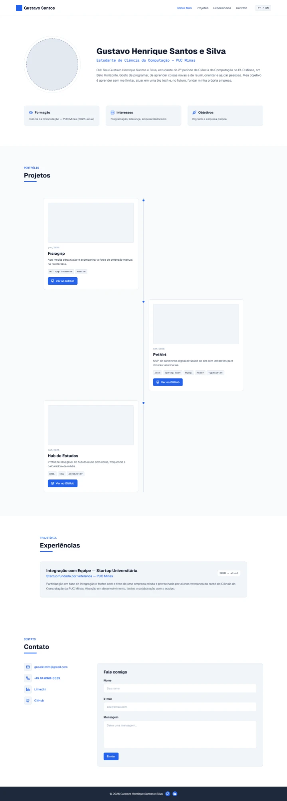
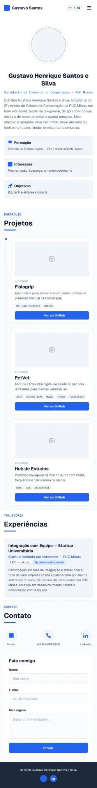
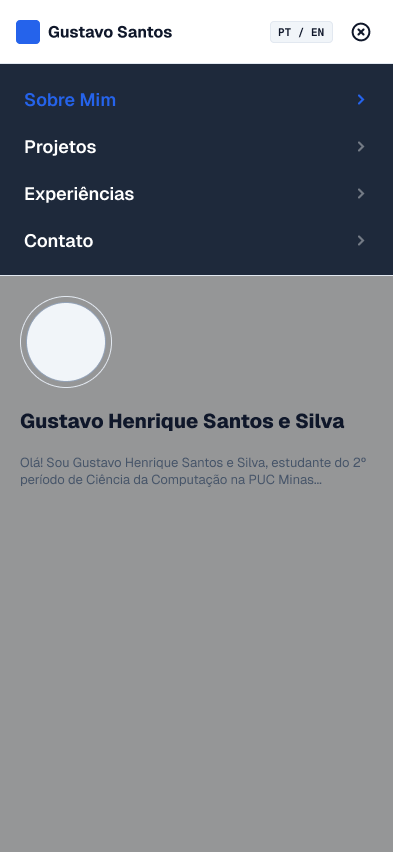

# 🏷️ Portfólio Profissional 👨‍💻

Portfólio bilíngue de **Gustavo Henrique Santos e Silva**, estudante de Ciência da Computação na PUC Minas. Projeto do Laboratório 01 de Desenvolvimento de Interfaces Web (DIW).

Este README adapta o [template obrigatório do laboratório](https://github.com/joaopauloaramuni/desenvolvimento-de-interfaces-web/blob/main/TEMPLATES/template_README.md) ao site estático, mantendo suas seções aplicáveis.

## 🚧 Status do Projeto

**Site implementado com Bootstrap e três projetos completos. Envio real aceito pelo EmailJS em 13/10/2026. Publicação no GitHub Pages em preparação.**

| Sprint | Estado verificável |
| --- | --- |
| 01 — Planejamento e protótipo | README e wireframes originais preservados; tecnologia documentada; site navegável implementado. As interações do modo de apresentação do Figma não foram verificadas. |
| 02 — Funcionalidades | PT/EN, timeline, experiência, contatos, responsividade e validação implementados. Fisiogrip com mídia real e repositório. Envio real aceito pelo EmailJS; confirmação na caixa de entrada pendente. |
| 03 — Finalização | Capturas, documentação e roteiro preparados. Publicação em preparação no repositório gustavoalkimim/Portifolio. |

## 📚 Índice

- [Links Úteis](#-links-úteis)
- [Sobre o Projeto](#-sobre-o-projeto)
- [Funcionalidades Principais](#-funcionalidades-principais)
- [Tecnologias Utilizadas](#-tecnologias-utilizadas)
- [Arquitetura](#-arquitetura)
- [Protótipos](#-protótipos-wireframes)
- [Instalação e Execução](#-instalação-e-execução)
- [Deploy](#-deploy)
- [Estrutura de Pastas](#-estrutura-de-pastas)
- [Demonstração](#-demonstração)
- [Testes](#-testes)
- [Documentações utilizadas](#-documentações-utilizadas)
- [Autores](#-autores)
- [Contribuição](#-contribuição)
- [Agradecimentos](#-agradecimentos)
- [Licença](#-licença)

## 🔗 Links Úteis

- Repositório desta entrega: [gustavoalkimim/Portifolio](https://github.com/gustavoalkimim/Portifolio).
- Design: [Portfólio Profissional no Figma](https://www.figma.com/design/nzWPeHdlCoLC9QCtnpro4x/Portifolio-Profissional?node-id=0-1).
- GitHub pessoal: [gustavoalkimim](https://github.com/gustavoalkimim).
- LinkedIn: [Gustavo Alkimim](https://linkedin.com/in/gustavo-alkimim-73091b24a).
- Site publicado: **ainda não publicado**. Registrar a URL real nesta seção depois da publicação e do teste.

## 📝 Sobre o Projeto

Uma página única reúne apresentação, formação, interesses, objetivos, projetos, trajetória e contato. O conteúdo pessoal vem do Figma e do README original. As descrições dos projetos também foram conferidas nos respectivos repositórios.

A implementação usa o desenho já existente: fundo branco/cinza claro, destaque azul, fontes Geist/Geist Mono, cartões de informação e linha do tempo alternada no desktop. No celular, os cartões ficam em uma coluna e o menu abre abaixo do cabeçalho.

Não foram adicionadas biografia, habilidades, métricas, empresas ou experiências sem fonte. As datas dos projetos são os meses apresentados no Figma; não representam as datas de criação dos repositórios. Os dois itens de iniciação científica “2027 previsto” não aparecem no site.

## ✨ Funcionalidades Principais

- Navegação por âncoras, cabeçalho persistente, rodapé e menu mobile com fechamento por link, botão, fundo ou Escape.
- Português e inglês: biografia, informações, experiência, descrições dos projetos, legendas, navegação, formulário, erros, status, textos alternativos e rótulos acessíveis. O idioma é salvo localmente quando o navegador permite.
- Timeline dinâmica ordenada do mais antigo ao mais recente: Fisiogrip (jul/2026), PetVet e Hub de Estudos (set/2026).
- Captura real do Fisiogrip obtida em seu repositório, e capturas do PetVet e do Hub em execução local, com link para abrir a imagem em tamanho completo. Os dados ilustrativos dessas interfaces estão identificados nas legendas. Textos dentro das capturas pertencem aos projetos originais, que usam português.
- Experiência de integração com startup universitária da PUC Minas, conforme o Figma.
- E-mail, GitHub, LinkedIn e WhatsApp com destinos confirmados. O LinkedIn e o GitHub indicados pelo usuário substituem endereços divergentes do wireframe.
- WhatsApp com número completo `+55 (31) 98266-5639` em desktop e celular, conforme a preferência atual do proprietário.
- Formulário com nome, e-mail e mensagem, validação, campos preservados em erro e proteção contra envio duplicado enquanto aguarda a resposta.
- Retorno de envio somente quando a API do EmailJS responde com sucesso. Sem configuração, o formulário informa claramente que a mensagem não foi enviada.
- Layout responsivo, foco visível, rótulos de formulário, link para pular ao conteúdo e respeito à preferência de reduzir movimento.

### Pendências

1. **EmailJS:** conferir o recebimento na caixa de entrada de `gusalkimim@gmail.com`; a API aceitou o teste `PORTFOLIO-20261013-A5`.
2. **Hub de Estudos:** conceder acesso ao avaliador ou decidir tornar o projeto público; o repositório continua privado.
3. **Publicação:** aguardar a conclusão e o teste do GitHub Pages.

Foto pessoal, e-mail oficial, número completo do WhatsApp, repositório e captura do Fisiogrip já estão incluídos.

## 🛠 Tecnologias Utilizadas

| Tecnologia | Versão ou padrão | Uso |
| --- | --- | --- |
| HTML | HTML5 / HTML Living Standard | Estrutura semântica e campos do formulário |
| CSS | CSS moderno e Bootstrap 5.3.8 | Aparência e responsividade |
| Bootstrap | 5.3.8, CSS via CDN com verificação de integridade | Grid, cards, botões, formulário e espaçamentos |
| JavaScript | ES2015+ com Fetch, Intl, IntersectionObserver e AbortController | Conteúdo, idioma, menu e formulário |
| EmailJS | REST API v1.0 | Envio de e-mail após configuração |
| Geist e Geist Mono | Arquivos TTF locais; licença SIL OFL 1.1 | Fontes do desenho original |
| Figma | Serviço online | Referência dos wireframes |

**Biblioteca de interface: Bootstrap 5.3.8.** Adicionada por solicitação do proprietário para reduzir o CSS próprio. Mantidos HTML e JavaScript puros, sem React, Vue, Tailwind, instalação de pacotes ou etapa de build. Não há Spring Boot no portfólio; essa tecnologia pertence ao projeto PetVet apresentado na timeline.

As fontes, ícones e imagens estão locais. O CSS do Bootstrap é carregado por CDN; é necessário acesso à internet para carregar essa biblioteca e enviar mensagens. O script do Bootstrap não é necessário: o menu e o idioma são controlados por script.js.

## 🏗 Arquitetura

| Arquivo | Responsabilidade |
| --- | --- |
| `index.html` | Cabeçalho, seções, contatos, formulário e rodapé |
| `style.css` | Fontes, tokens, componentes e regras responsivas |
| `script.js` | Identificadores públicos do EmailJS, textos PT/EN, dados dos projetos, funções de navegação e envio |
| `assets/` | Ícones, fontes e imagens locais |
| `docs/` | Wireframes preservados, capturas e orientações |

HTML, CSS e JavaScript ficam separados, sem estilos, manipuladores de eventos ou scripts inline.

**Fluxo de envio:** navegador → validação → POST HTTPS para EmailJS → serviço de e-mail conectado na conta do proprietário → caixa do destinatário. O navegador exibe sucesso somente após a confirmação da API; erros de rede, rejeição e limite de requisições recebem mensagens próprias. Não há servidor ou banco de dados mantido por este projeto. O EmailJS é o componente externo responsável por encaminhar a mensagem.

### Configuração do formulário

Siga [docs/CONFIGURACAO.md](docs/CONFIGURACAO.md). Os três campos públicos ficam no objeto `EMAILJS`, no início de `script.js`:

```javascript
const EMAILJS = {
    serviceId: 'service_j8x2n98',
    templateId: 'template_zopdxbp',
    publicKey: 'DE3aJQUg4Su63Vq9E'
};
```

Os identificadores recebidos já foram inseridos. O destinatário oficial é `gusalkimim@gmail.com`, definido no template da conta. Não usar senhas, chaves privadas ou accessToken no front-end. O teste real `PORTFOLIO-20261013-A5` foi aceito pelo serviço, com retorno de sucesso e limpeza dos campos. O recebimento na caixa de entrada depende da confirmação do proprietário.

## 🎨 Protótipos (Wireframes)

As três imagens do repositório original foram preservadas sem alteração:

| Desktop | Mobile | Menu mobile |
| --- | --- | --- |
|  |  |  |

A implementação foi conferida contra os frames desktop e mobile do Figma. A foto pessoal fornecida ocupa o círculo reservado no desenho, com enquadramento por CSS; o arquivo original da foto foi copiado sem alteração. As mídias reais dos projetos ocupam os lugares reservados no desenho. Nenhum frame do Figma foi alterado.

## 🔧 Instalação e Execução

### Pré-requisitos

Um navegador atual (Chrome, Edge, Firefox ou Safari). Para testar o formulário configurado, usar um servidor HTTP local. Python 3 ou a extensão Live Server do VS Code são opções.

### Instalação de dependências

**Não há dependências para instalar nem build.** Abra esta pasta, que contém os arquivos do site e a documentação da entrega.

### Como executar

Para visualizar o site, abra `index.html` no navegador. Para executar com servidor local, abra um terminal dentro de `Avaliado`:

```powershell
python -m http.server 8000 --bind 127.0.0.1
```

Abra [http://127.0.0.1:8000](http://127.0.0.1:8000). Pare o servidor com Ctrl+C. O formulário deve ser testado por HTTP/HTTPS; serviços externos podem rejeitar a origem `file://`.

### Variáveis de ambiente

Não há `.env` nem variáveis de ambiente. Os IDs e a chave pública do EmailJS ficam no objeto `EMAILJS` em `script.js`. O destinatário é configurado no template do EmailJS, não escolhido pelo visitante.

## 🚀 Deploy

**Ainda não publicado.** Após a publicação, registrar a URL real e testar o recebimento de e-mail.

### GitHub Pages

1. No repositório que você escolher, colocar **o conteúdo de `Avaliado` na raiz**, incluindo `index.html`, `style.css`, `script.js`, `assets`, `docs`, README e `.nojekyll`.
2. Configurar o EmailJS conforme a documentação antes de testar o envio publicado.
3. No GitHub: Settings → Pages → Deploy from a branch → selecionar a branch e `/ (root)`.
4. Aguardar a publicação e usar a URL exibida pelo GitHub. Não presumir a URL antes de ela existir.
5. Adicionar essa origem à configuração de domínios do EmailJS quando disponível, testar navegação, mídia, PT/EN e o recebimento da mensagem.
6. Registrar a URL testada em “Links Úteis”.

No plano GitHub Free, Pages exige repositório público. Escolher a visibilidade do novo repositório conscientemente ou usar Vercel. O envio via EmailJS é compatível com hospedagem estática, pois é uma chamada HTTPS a um serviço externo. Os caminhos do site são relativos e foram testados em uma subpasta como a usada por Pages.

### Vercel

Alternativa já prevista no README original: importar o repositório de destino, usar preset **Other**, sem comando de build e servir a raiz contendo `index.html`. Se o repositório guardar a pasta `Avaliado`, escolher `Avaliado` como Root Directory. Configurar o EmailJS para a origem publicada e registrar a URL real após os testes.

**Esta pasta contém os arquivos da entrega.** Colocar seu conteúdo na raiz do novo repositório.

## 📂 Estrutura de Pastas

```text
Avaliado/
├── index.html
├── style.css
├── script.js
├── README.md
├── LICENSE
├── .nojekyll
├── assets/
│   ├── fonts/       # Fontes e licença OFL
│   ├── icons/       # Ícones locais do Figma e favicon
│   └── images/      # Foto pessoal e capturas dos projetos
└── docs/
    ├── wireframes/  # Três arquivos originais, sem alterações
    ├── demo/        # Capturas desktop/mobile em PT e EN
    ├── CONFIGURACAO.md
    ├── DEMONSTRACAO.md
    └── LICENCA_FISIOGRIP.txt
```


## 🎥 Demonstração

Roteiro de aproximadamente três minutos: [docs/DEMONSTRACAO.md](docs/DEMONSTRACAO.md).

| Tela | Captura |
| --- | --- |
| Desktop em português | [Abrir](docs/demo/desktop-pt.png) |
| Desktop em inglês | [Abrir](docs/demo/desktop-en.png) |
| Celular em português | [Abrir](docs/demo/mobile-pt.png) |
| Celular em inglês | [Abrir](docs/demo/mobile-en.png) |

## 🧪 Testes

Código, recursos locais e estrutura foram conferidos por verificações locais; navegação, traduções, validação e responsividade foram testadas no navegador. As ferramentas de verificação ficam fora desta pasta.

| Verificação | Resultado |
| --- | --- |
| 320, 394, 768, 1024 e 1440 pixels efetivos, em PT e EN | Aprovada, sem transbordamento horizontal |
| Menu e âncoras em celular e desktop | Aprovada |
| Conteúdo, atributos acessíveis, placeholders e status PT/EN | Aprovada |
| Preferência de idioma após recarregar | Aprovada |
| Abertura via servidor local | Aprovada; publicação em subpasta a conferir após o deploy |
| Fontes, ícones e mídias presentes | Carregaram sem erros no navegador |
| Timeline cronológica, número completo do telefone e ausência dos itens previstos | Aprovada |
| Campos vazios, só espaços e e-mail inválido | Rejeitados com mensagens claras |
| Integração EmailJS | Envio real aceito com template_zopdxbp; retorno de sucesso e campos limpos |
| Falha real do EmailJS | Mensagem de erro exibida e campos preservados |
| Envio duplicado enquanto aguarda o serviço | Bloqueado |
| Recebimento real de e-mail | Aguardando confirmação na caixa de entrada pelo proprietário |
| URL pública do portfólio | Publicação em preparação |

Links dos projetos foram conferidos usando a conta GitHub autenticada. Fisiogrip e PetVet são públicos e o Hub é privado. Os destinos de contato correspondem aos dados fornecidos. Não foram enviadas mensagens pelo WhatsApp ou LinkedIn. O envio real do formulário foi aceito pelo EmailJS.

Testes anteriores com respostas interceptadas verificaram o tratamento de sucesso, erros, limites e falhas de rede. Nesta revisão, o teste real com o template configurado foi aceito pelo EmailJS. A aceitação da API e a confirmação do recebimento são registradas separadamente.

## 🔗 Documentações utilizadas

- [Template do README](https://github.com/joaopauloaramuni/desenvolvimento-de-interfaces-web/blob/main/TEMPLATES/template_README.md).
- PDFs do Laboratório 01 e resumo fornecidos pelo proprietário.
- [Bootstrap 5.3](https://getbootstrap.com/docs/5.3/getting-started/introduction/).
- [REST API /send do EmailJS](https://www.emailjs.com/docs/rest-api/send/).
- [Criação de site no GitHub Pages](https://docs.github.com/en/pages/getting-started-with-github-pages/creating-a-github-pages-site).
- [Vercel](https://vercel.com/docs).
- [MDN Web Docs](https://developer.mozilla.org/pt-BR/).
- [Design do portfólio no Figma](https://www.figma.com/design/nzWPeHdlCoLC9QCtnpro4x/Portifolio-Profissional?node-id=0-1).
- [Fisiogrip / FisioGrasp](https://github.com/Mavilaa/Fisiogrip), fonte da captura e tecnologias; licença preservada em [docs/LICENCA_FISIOGRIP.txt](docs/LICENCA_FISIOGRIP.txt).
- [PetVet](https://github.com/gustavoalkimim/petvet) e [Hub de Estudos](https://github.com/gustavoalkimim/Projeto_HUB), fontes das descrições, tecnologias e capturas.
- [Geist](https://github.com/vercel/geist-font), fontes sob SIL OFL.

## 👥 Autores

**Titular do portfólio e das informações pessoais:** Gustavo Henrique Santos e Silva — [GitHub](https://github.com/gustavoalkimim) · [LinkedIn](https://linkedin.com/in/gustavo-alkimim-73091b24a).

Conferir as regras da disciplina e os créditos aplicáveis aos materiais utilizados.

A organização de HTML e CSS foi estudada a partir do [portfólio de Lucas Barbosa](https://github.com/Lucas-tech255/portfolio). O desenho, conteúdo e implementação foram adaptados para este portfólio.

## 🤝 Contribuição

Revisar os arquivos e testar localmente antes de integrar mudanças.

## 🙏 Agradecimentos

Prof. Dr. João Paulo Aramuni, pelas orientações do laboratório e pelo template de documentação.

## 📄 Licença

MIT, conforme a escolha registrada no README original. Ver [LICENSE](LICENSE). As fontes têm licença própria em `assets/fonts/OFL.txt`. Informações pessoais e conteúdo de terceiros devem ser usados com os direitos correspondentes.
